<!-- budget 80 slides -->
<!-- sections: i) mechanisms, ii) population, iii) cancer, iv) fusion, v) visualization -->
<!-- ~15 slides per section -->
<!-- presentation should be < 1 hr -->

## Structural variant (SV)

## What causes endogenous SVs?

:::{.center}

 

**Homology**

ATCGATCG **Seq. 1**
 
AACGAACG **Seq. 2**

 

**Repeats**

TAAAAAAT **Seq. 1**
 
CAAAAAAT **Seq. 2**

:::

::: notes
"Repeats" -> "replication failures".
"Homology" -> "recombination"
:::

## SV types

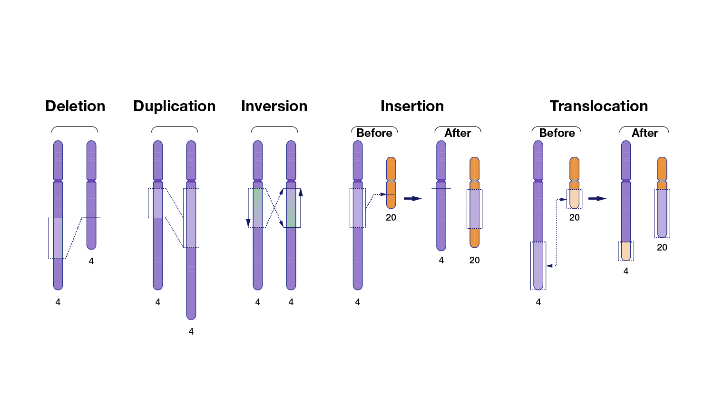

## Large base pair effect size of SVs

Number of SVs per person seems underestimated
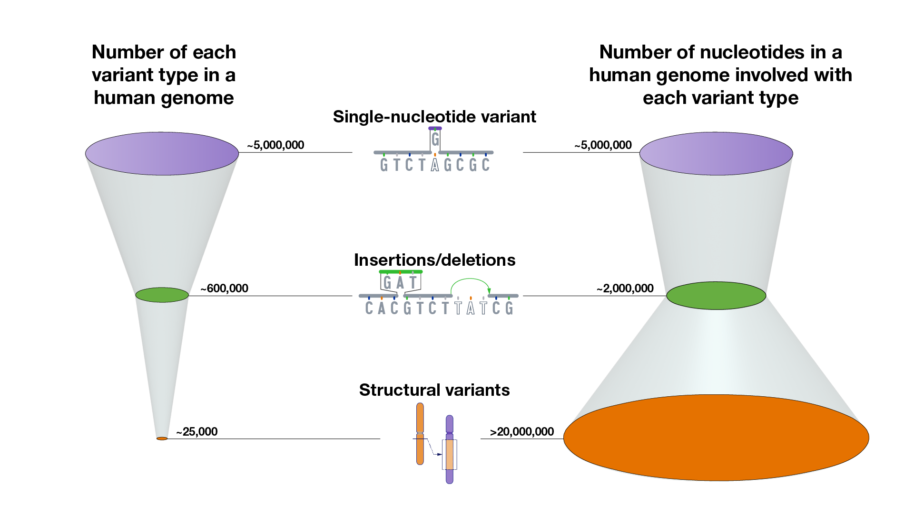

## SV recipe

:::{.small}
:::{.center}
1. Where: homology, repeats, double-strand breaks, and replication forks
2. When: synthesis, recombination, or repair
:::
:::

::::{.columns}
:::{.column width="50%"}
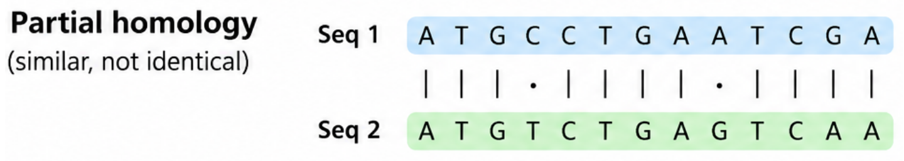{fig-align="center"}
:::
:::{.column width="50%"}
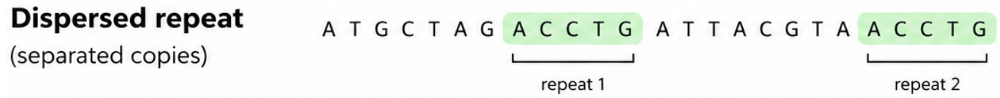{fig-align="center"}
:::
::::

::::{.columns}
:::{.column width="50%"}
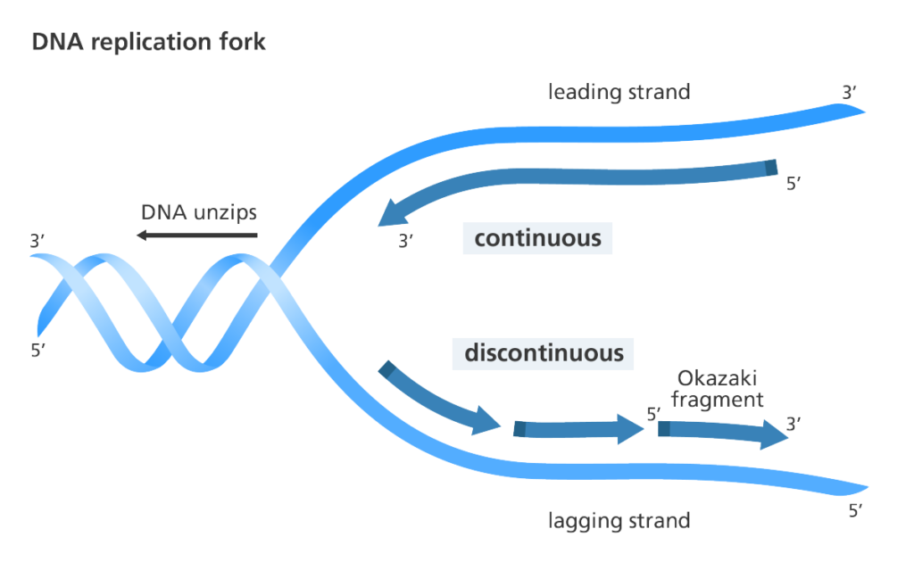{fig-align="center"}
:::
:::{.column width="50%"}
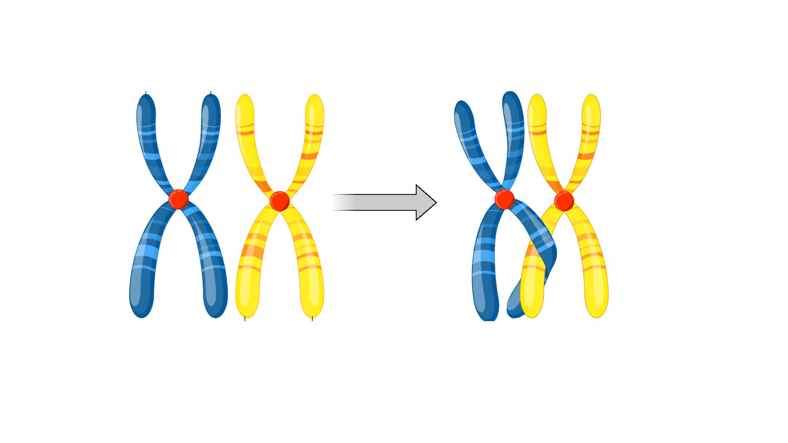{fig-align="center"}
:::
::::

::: notes
maybe animate with 2 slides
:::

# SV mechanisms

## SV mechanism research gaps

 

:::{.center}

- Calling *dependent* SVs
- Calling SVs using sequencing and mechanism models jointly
- Which mechanisms are most frequent?
- Association of mechanisms and pathologies

:::

## Allelic homologous recombination

{fig-align="center"}

## Non-allelic homologous recombination

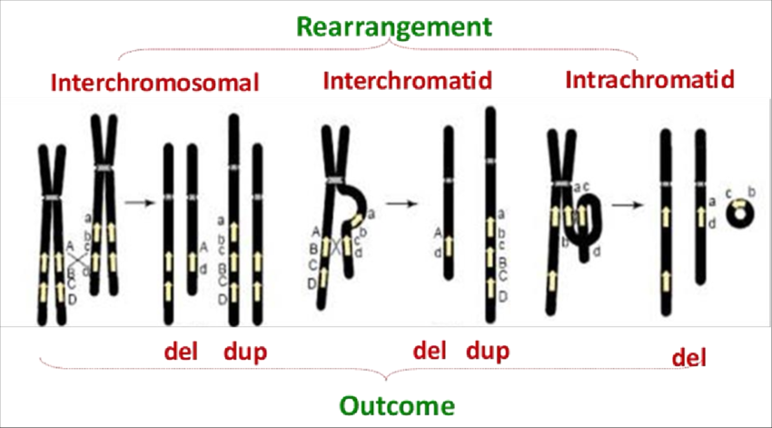{fig-align="center"}

## Smith-Magenis syndrome

:::{.small}
:::{.center}

 

NAHR SV near RAI1 and nearby genes on CHR 17

 

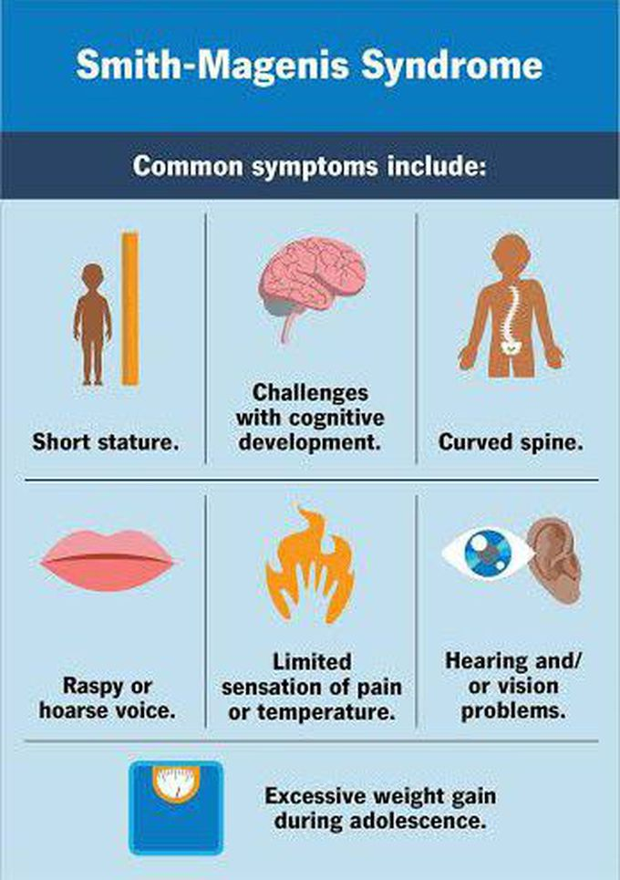{fig-align="center" width="30%"}

:::
:::

## Segmental duplications drive NAHR

 

:::{.center}
:::{.small}

- Segmental duplications (SDs) recruit NAHR
- ~5% of human genome
- High identity (>~95%)
- Large (>~10kbp)

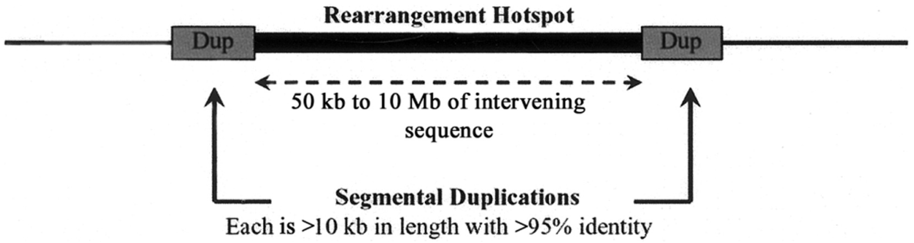

:::
:::

## NAHR DEL-DUP

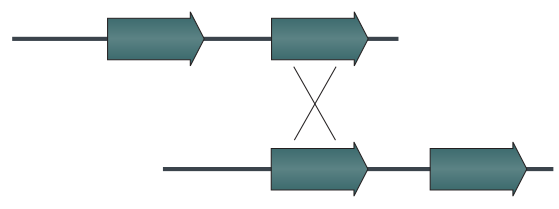

## NAHR DEL-DUP

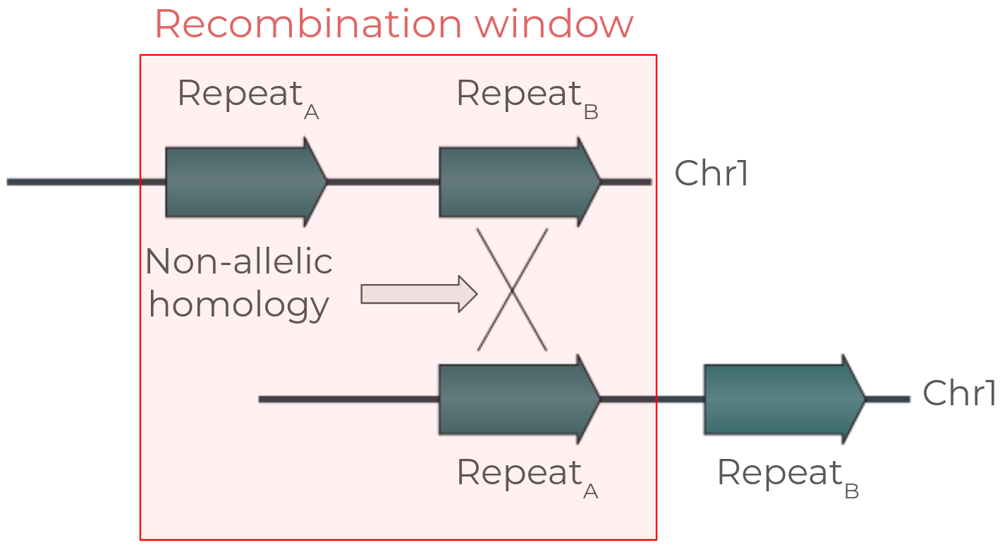

## NAHR DEL-DUP

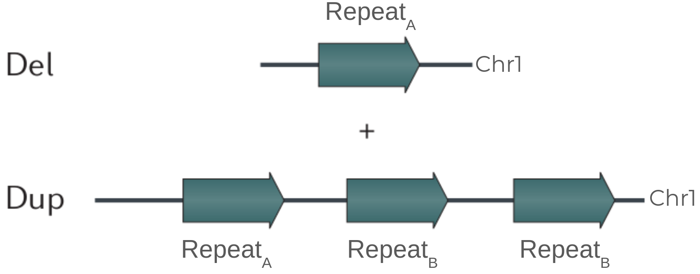

## NAHR elements and risk

 

:::{.small}
:::{.center}

| Homologous element | Min. Seq. identitiy | Min. length | 
| ----- | ----- | ----- |
| Segmental duplication (SD) | 90% | 1kbp |
| Long interspersed nuclear element (LINE) | 96% | smaller than 1kbp |
| Human endogenous retro virus (HERV) | 93% | 3kbp | 

 

- Risk $\propto$ length & sequence identity
- Risk $\frac{1}{\propto}$ distance between elements

:::
:::

::: notes

citation? probably one of the SV mech papers

:::

## NAHR summary

 

:::{.center}

- Recombination at homologous, but non-matching loci
- Breakpoints have large homology
- Example: Smith-Magenis syndrome
- Relatively high reurrency

:::

## Non-homologous end joining (NHEJ)

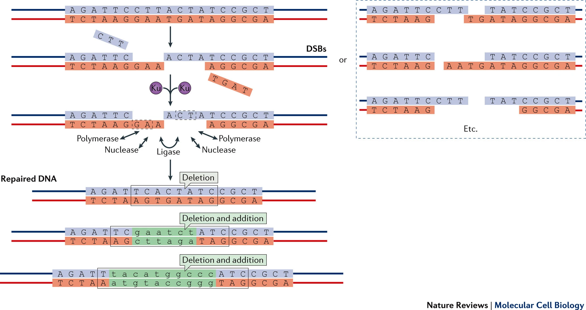{fig-align="center"}

## Chronic myeloid leukemia fusion

:::{.small}
:::{.center}
- NHEJ SV hypothesis (minimal breakpoint homology)
- Recurrency hypothesis: CHR9 and CHR22 regions are physically close

:::
:::

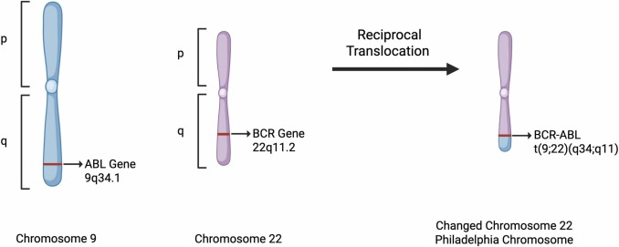{fig-align="center"}

## NHEJ example

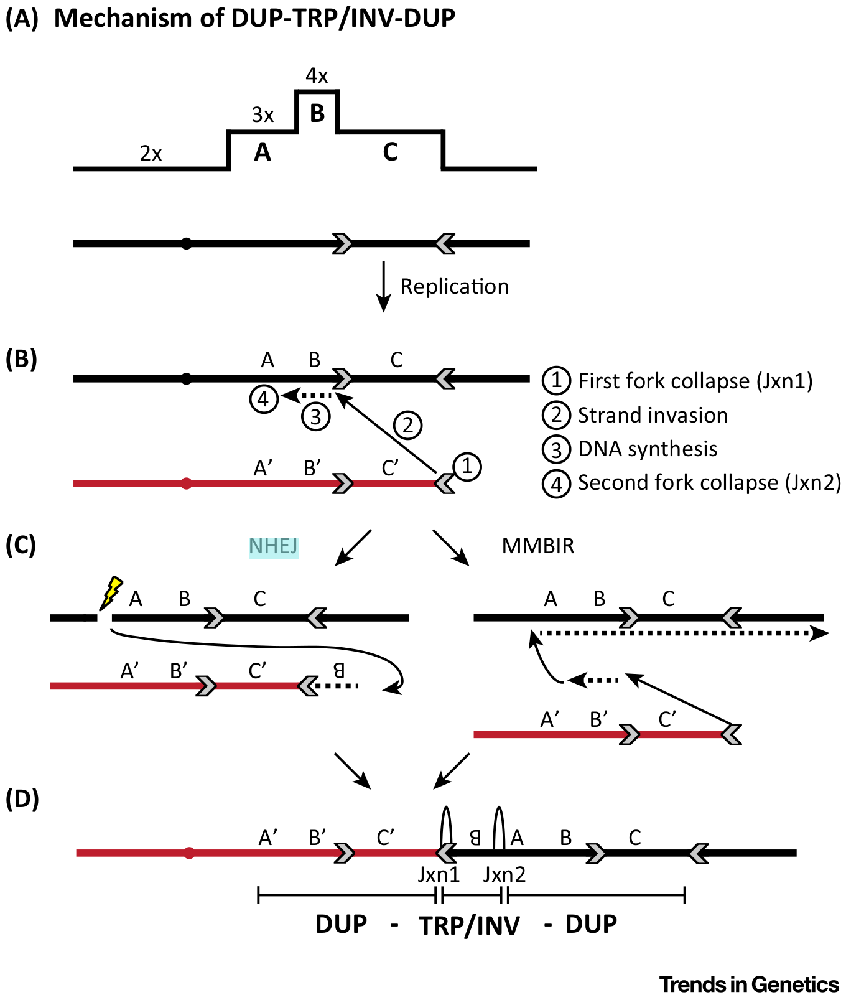{fig-align="center"}

## NHEJ summary

 

:::{.center}

- Imperfect repair of double strand DNA break
- Minimal homology at breakpoints
- Example: BCR-ABL1 fusion CML
- *Usually* low recurrency

:::

## Break-induced replication (BIR)

 

 

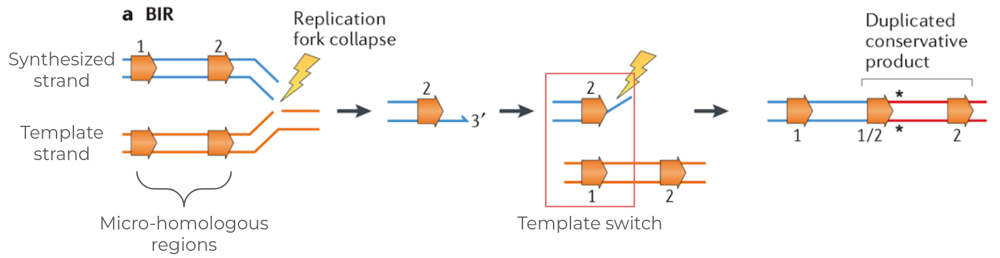{fig-align="center"}

<!-- from Mechanisms underlying structural
variant formation in genomic disorders -->

## Temple syndrome

:::{.center}

 

- BIR SV: CHR 14 DUP-TRP/INV-DUP
- Symptoms
  - Intellectual disabilities
  - Early onset puberty

:::

## BIR summary

- Replication template switching due to microhomology
- Breakpoints show microhomology
- Example: Temple syndrome; CHR 14 DUP-TRP/INV-DUP
- Low recurrency

<!-- ## Template switch DEL and DUP

 

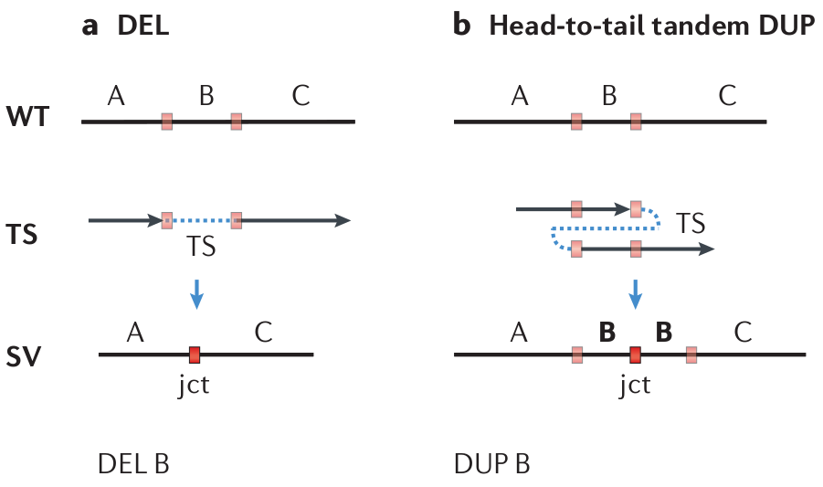{fig-align="center"} -->

## Fork stalling and template switching (FoSTeS)

:::{.center}

Template switching during replication

 

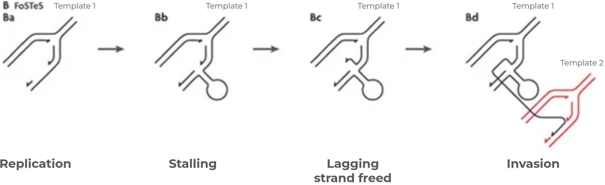{fig-align="center"}

:::

## Pelizaeus-Merzbacher disease

 

:::{.center}

- Mechanism: CHR X DUP; PLP1 gene
- Symptoms:
  - Involuntary movements
  - Developmental delays
:::

## FoSTeS summary

:::{.center}

 

- Template switching from one replication fork to another
- Breakpoints have microhomology
- Example: Pelizaeus-Merzbacher disease
- Low recurrency

:::

## SV mechanisms

:::{.small}
:::{.center}

| Mechanism | When | Recurrency | Breakpoint homology | Ex. pathology |
| ----- | ----- | ----- | ----- |
| NAHR | Recombination | Relatively high | Large | Smith–Magenis syndrome; DEL on CHR 17, RAI1 gene |
| NHEJ  | Repair | Low | None or small | Chronic Myeloid Leukemia; FUSION of BCR-ABL genes |
| BIR | Replication | Low | Small | Temple syndrome; DEL on CHR 14 |
| FoSTeS | Replication | Low | Small | Pelizaeus-Merzbacher; DUP CHR X, PLP1 gene | 

:::
:::

::: notes

- NAHR pathology: Mechanisms underlying structural variant formation in genomic disorde
- BIR pathology: https://www.nature.com/articles/s41594-025-01644-z#Sec5 table1
- NHEJ pathology: Distinct pattern of genomic breakpoints in CML and BCR::ABL1-positive ALL: analysis of 971 patients
- FoSTeS pathology: https://pmc.ncbi.nlm.nih.gov/articles/PMC2685756/

:::

## SV mechanism research gaps

 

:::{.center}

- Calling *dependent* SVs
- Calling SVs using sequencing and mechanism models jointly
- Which mechanisms are most frequent?
- Association of mechanisms and pathologies

:::

## Dependent SVs and mechanisms

:::{.center}
:::{.small}
- A single NHEJ event may produce multiple SVs
- NAHR rarely produces insertions
- Breakpoint sequence could rule out SV dependence
  - E.g., INS+DEL with large homology at DEL breakpoints
:::

{fig-align="center" width="75%"}

:::

## Dependent SVs as "Complex SVs"

:::{.center}
Severus

:::{.small}

- Breakpoint coordinates used for merging
- Breakpoint sequence not leveraged for resolving complex SV

:::
:::

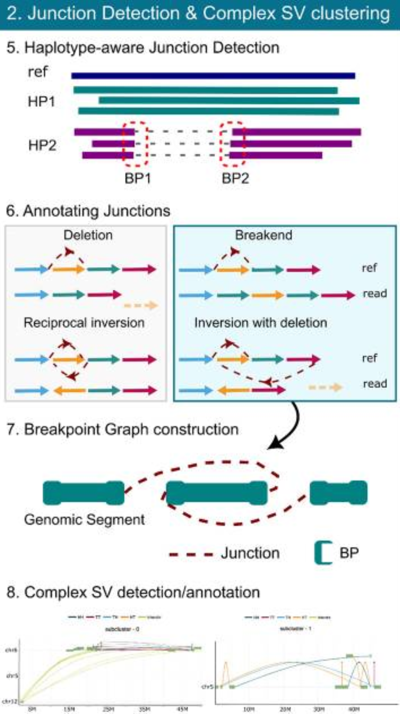{fig-align="center" width="50%"}

## Severus complex SVs

:::{.center}
Annotates a pre-defined set of complex SVs
:::

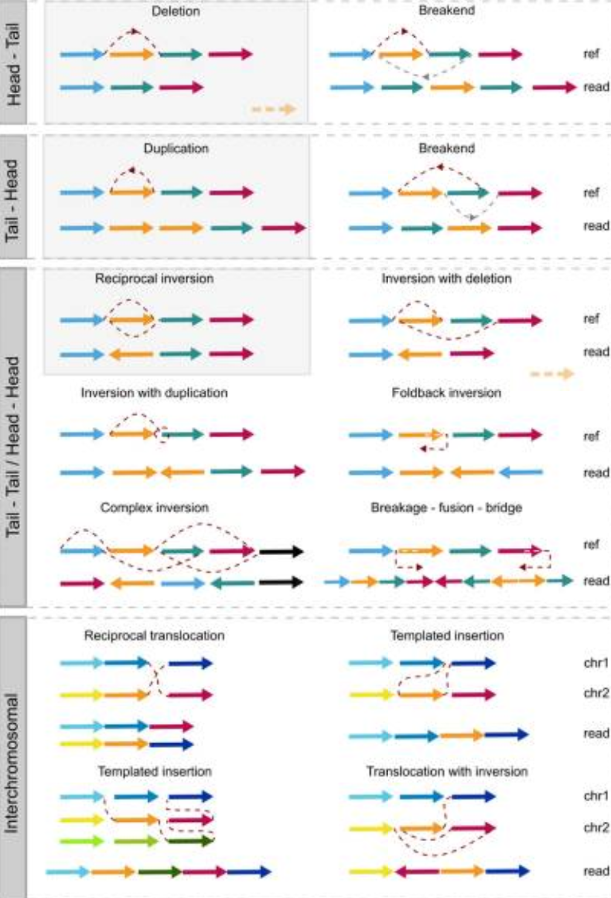{fig-align="center"}

## Many coordinates clusterers

 

:::{.center}

Breakpoint sequence not leveraged

 

::::{.columns}
:::{.column width="50%"}
 
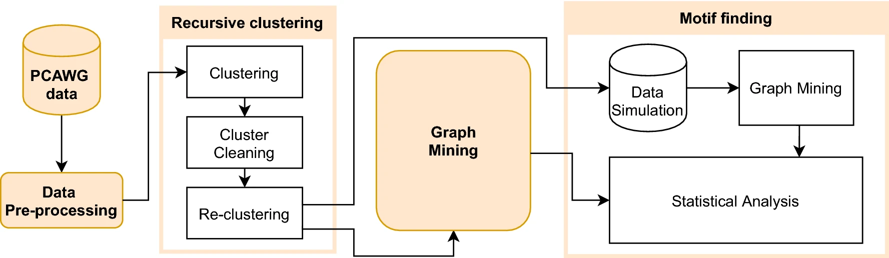{fig-align="center"}
:::
:::{.column width="50%"}
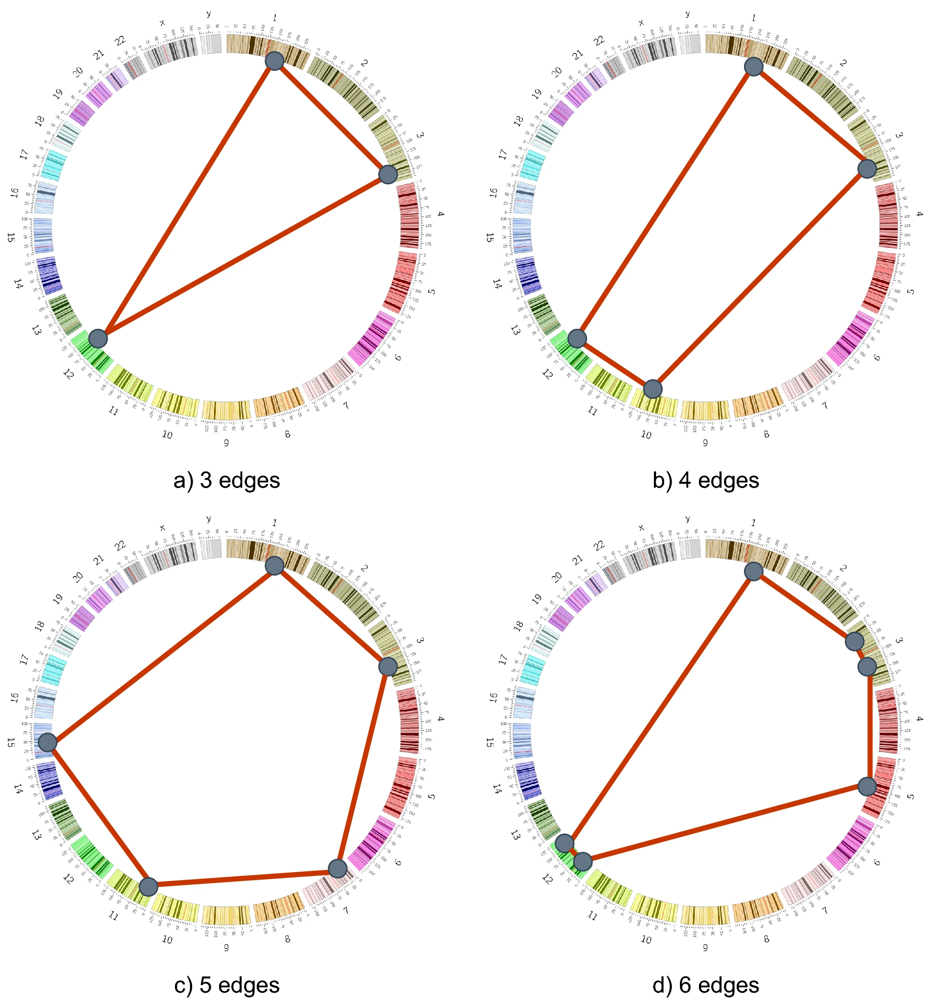{fig-align="center" width="70%"}
:::
::::

:::

# SVs in human population

## Appendix

- [Papers](https://docs.google.com/document/d/1ITRce8UJdXp1rDq0sjtYXVW5guFNf2iaTkP0BkiCHbA/edit?usp=sharing)
