## Structural variants (SVs)

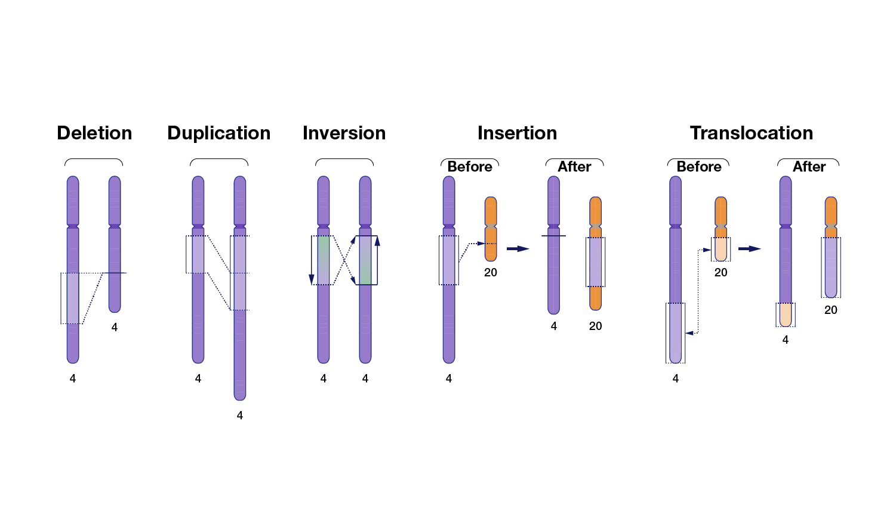{fig-align="center"}

:::notes
- Structural variants are primary variation I will discuss
- They are large mutations deviating from expected human genome sequence
- SVs types characterize how seq. varies from expected
- DEL: loss of sequence
- DUP: gain of existing seq.
- INV: reversal of order
- INS: gain of novel seq.
- TRANS: sequence misplaced compared to expected
:::

## Large base pair effect size of SVs

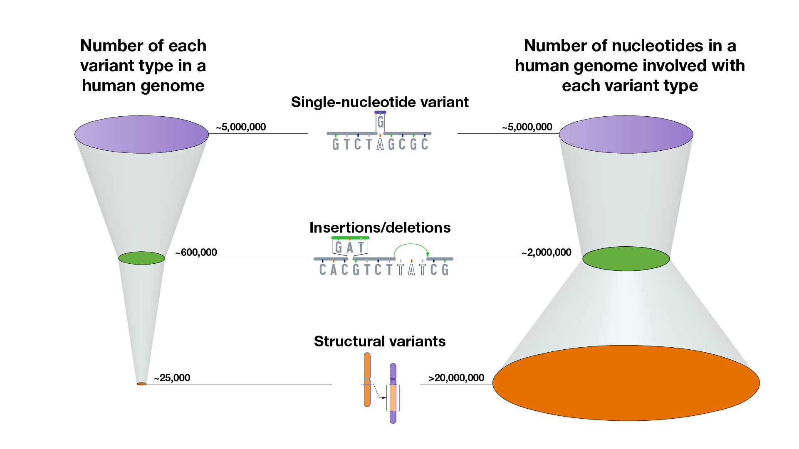

:::notes
- SVs are important because they contribute a large amount of total bp variation per genome
- Estimates vary, but genome.gov estimates >20Mbp of variation on avg.
- However, # SV events small (~25k) compared to SNPs and INDELs
:::

## Disease driving SVs

:::{.center}
:::{.small}

| Mechanism | When | Recurrency | Breakpoint homology | Ex. pathology |
| ----- | ----- | ----- | ----- | ----- | 
| NAHR | Recombination | Relatively high | Large | Smith–Magenis syndrome; DEL CHR 17, RAI1 |
| NHEJ  | Repair | Low | None or small | Leukemia; FUSION, BCR-ABL |
| BIR | Replication | Low | Small | Temple syndrome; DEL CHR 14 |
| FoSTeS | Replication | Low | Small | Pelizaeus-Merzbacher; DUP CHR X, PLP1 | 

:::
:::

:::notes
- SVs often causes disease
- Especially, neurological, developmental, and cancer diseases
- Therefore, there's clinical incentive to understand SVs:
  - What mechanisms cause them?
  - When do SV mechanisms occur?
  - Do they occur in multiple individuals (recurrency)?
  - Are they pathological?
:::

## Computation necessity

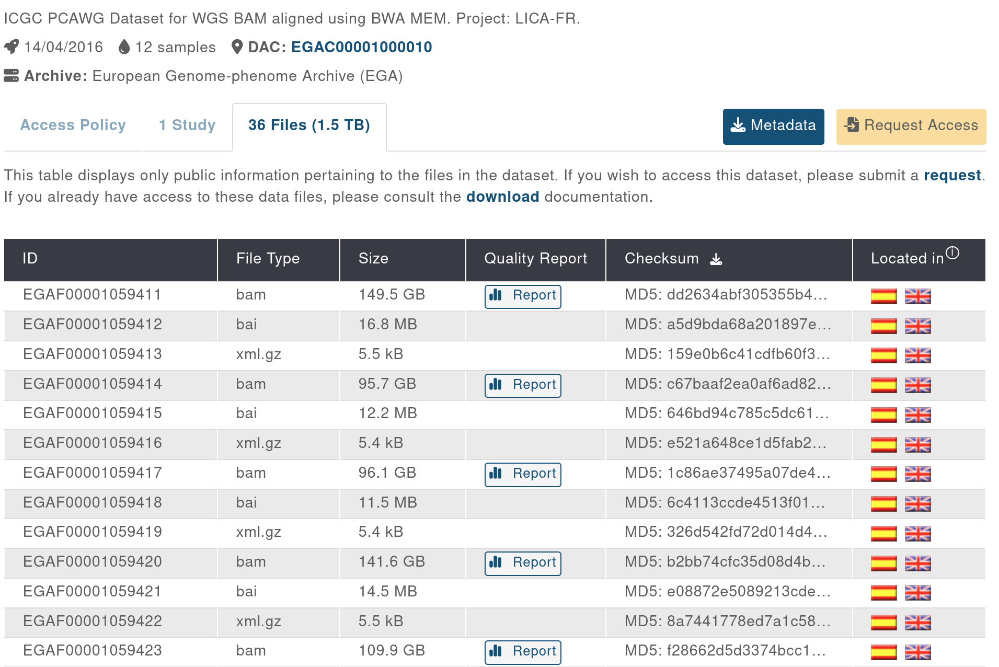{fig-align="center"}

<!-- ::::{.columns}
:::{.column width="70%"}
{fig-align="center"}
:::
:::{.column width="30%"}

 

:::
:::: -->

:::notes
- Computational approaches are necessary to answer these questions
- For example, a single tumor sample's binary format sequence alignment map can be over 100GB
- Disease analysis requires large samples sizes of both control and condition
- Therefore, sheer data size necessitates computational analysis
:::

## Sections

:::{.center}
:::{.small}
1. SV mechanisms
2. SVs in population
3. SVs in cancer
4. Gene fusions
5. SV visualization
:::
:::

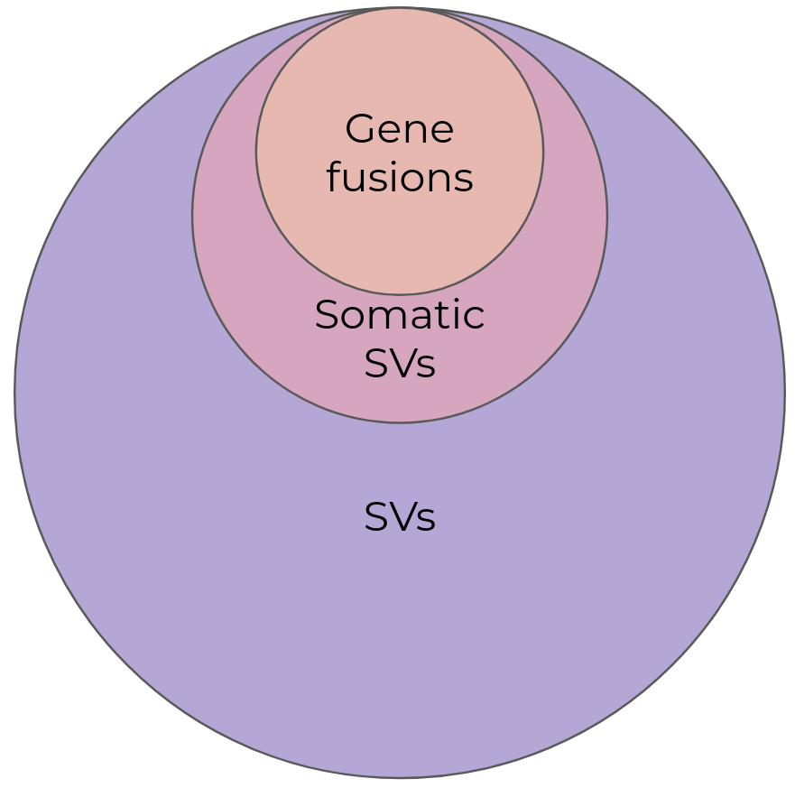{fig-align="center" width="70%"}

:::notes
- First, I will summarize mechanisms
- Second, look at population-scale SV analyses
- Third, SVs in cancer
- Fourth, investigate a special case of cancer SVs: gene fusions
- Fifth, conclude with SV viz methods, useful to verify if SV really exists

:::

# SV mechanisms

## SV recipe

:::{.small}
:::{.center}
1. Where: homology, repeats, double-strand breaks, and replication forks
2. When: synthesis, recombination, or repair
:::
:::

::::{.columns}
:::{.column width="50%"}
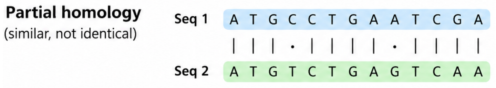{fig-align="center" width="70%"}
:::
:::{.column width="50%"}
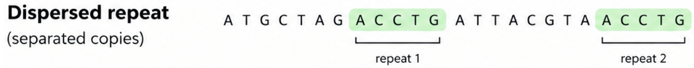{fig-align="center" width="70%"}
:::
::::

::::{.columns}
:::{.column width="50%"}
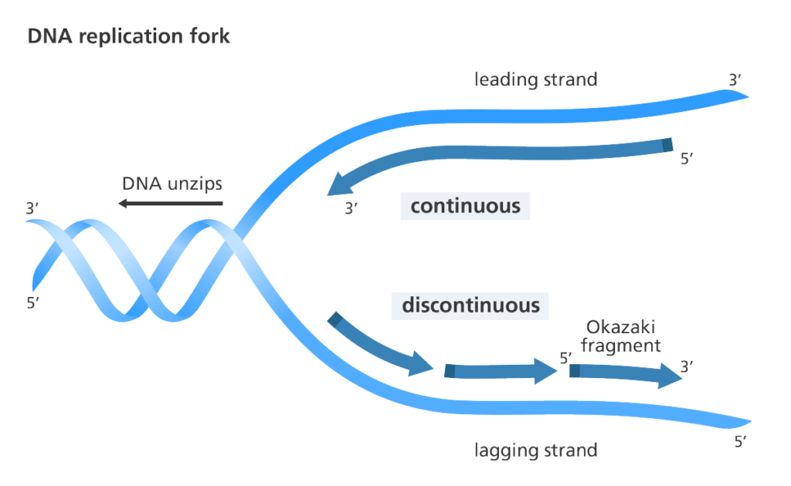{fig-align="center" width="70%"}
:::
:::{.column width="50%"}
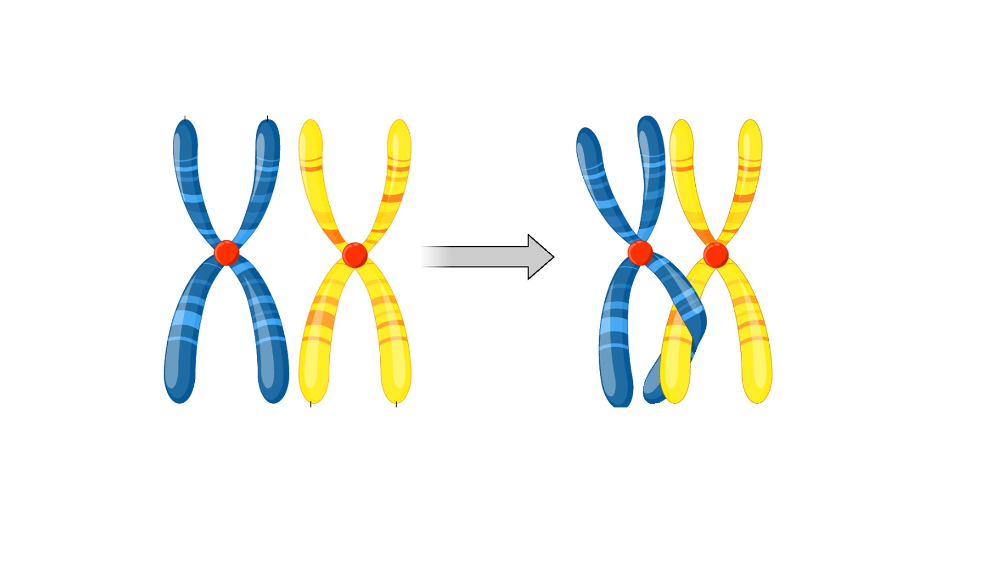{fig-align="center" width="70%"}
:::
::::

::: notes
- SV mechanisms vary by where and when they occur
- Where: repeats, damaged DNA, or replication forks
- When: synthesis, recombination, or repair
:::

## SV mechanism research gaps

 

:::{.center}

1. Calling dependent SVs
2. Calling SVs using sequencing and mechanism models jointly
3. Mechanism-pathology association

:::

- :::notes
- For each section, I want to pose potential research gaps to consider throughout and revisit this at the end
- In summary, there's a few gaps related to SV mechs.
- Calling dependent SVs, as we will see many SVs are not independent, yet SV callers typically do not leverage this. Usually analysis is done post-hoc.
- Second, leveraging mechanistic models during the call process is under-investigated and may improve the quality of callsets. Most methods use seq. data only
- Third, the association of mechanisms and pathologies is under-investigated mostly due to limited availability of large disease sample sizes
- So, consider if the papers I discuss support these putative gaps or not
:::

## Allelic homologous recombination

{fig-align="center"}

:::notes
The first mechanism involves recombination process where DNA is exchanged between homologous chromosomes at the same location or allele.
:::

## Non-allelic homologous recombination

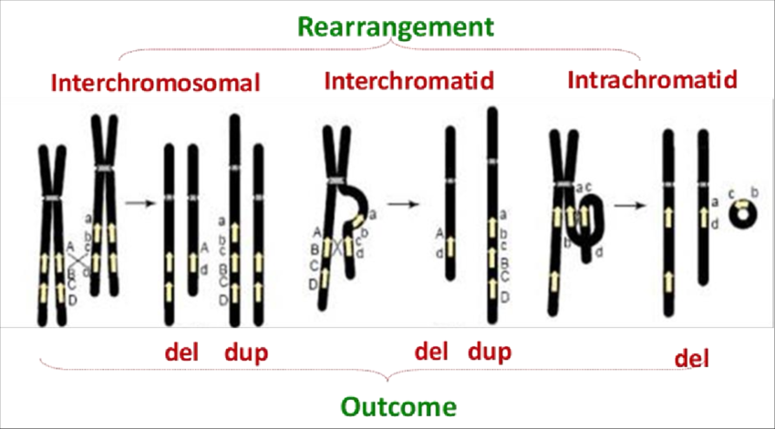{fig-align="center"}

:::notes
- However, 'non-allelic' homologous recombination is crossing over at two different sites causing SV
- For ex, 2 homologous chromosomes might line up incorrectly due to repeat homology 
- In the left example, the AB alleles of the 1st chromosome abnormally lines up with the CD alleles of the 2nd chromosome
- This may cause a DEL in one chromosome and a DUP in the other
:::

## Smith-Magenis syndrome

:::{.small}
:::{.center}

 

NAHR SV near RAI1 and nearby genes on CHR 17

 

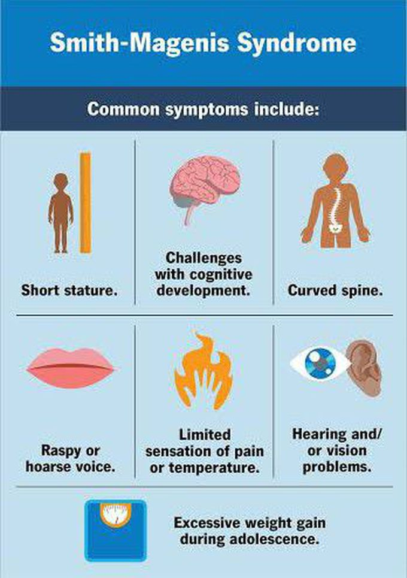{fig-align="center" width="20%"}

:::
:::

:::notes
- Smith-Magenis syndrome is hypothesized to be caused by NAHR nearby the RAI1 gene
- Symptoms include physical and developmental abnormalities
:::

## Segmental duplications drive NAHR

 

:::{.center}
:::{.small}

- Segmental duplications (SDs) recruit NAHR
- ~5% of human genome
- High identity (>~95%)
- Large (>~10kbp)

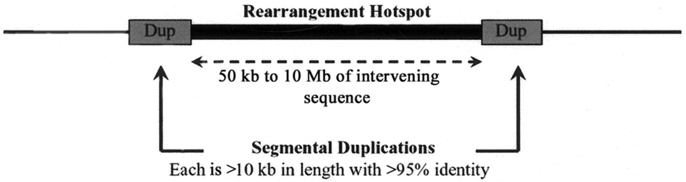

:::
:::

:::notes
- A canonical homologous element is the segmental duplication
- These are large highly homologous (high seq. similarity) elements
- The area around these elements is known to be a hotspot for NAHR
:::

## NAHR DEL-DUP

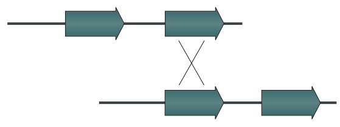

:::notes
- How exactly does this mechanism work?
- Say we have 2 chromosomes with 2 large, homologous repeats on each
:::

## NAHR DEL-DUP

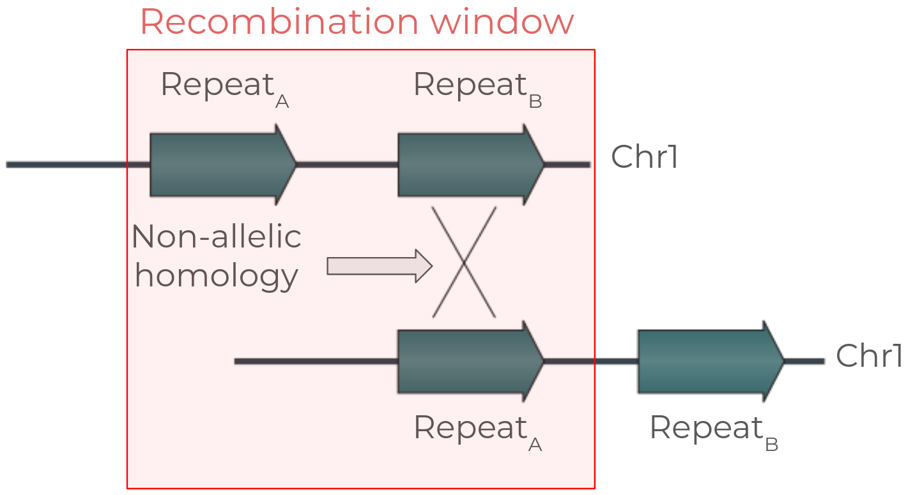

:::notes
- The recombination window might abnormally form like this
- And after crossing over, the top chromosome will only receive 1 repeat copy, while the bottom chr receives an extra third repeat copy
:::

## NAHR DEL-DUP

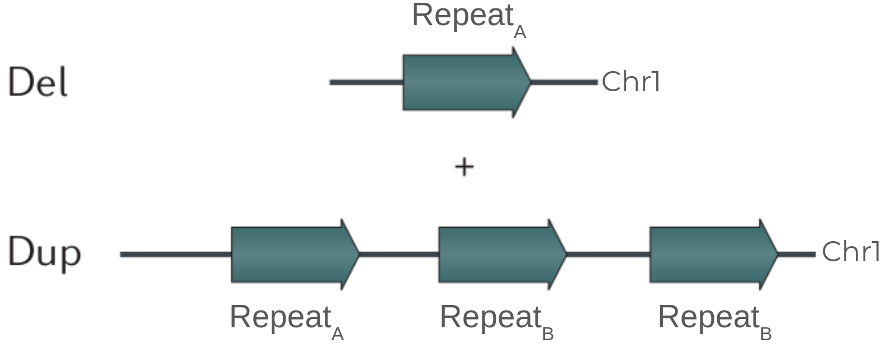

## NAHR elements and risk

 

:::{.small}
:::{.center}

| Homologous element | Min. Seq. identitiy | Min. length | 
| ----- | ----- | ----- |
| Segmental duplication (SD) | 90% | 1kbp |
| Long interspersed nuclear element (LINE) | 96% | smaller than 1kbp |
| Human endogenous retro virus (HERV) | 93% | 3kbp | 

 

- Risk $\propto$ length, sequence identity, closeness

:::
:::

::: notes
- Beyond SDs, other genomic elements are known to cause SVs via NAHR: LINE and HERV
- The SV risk of NAHR increases as the repeats are larger or more similar
- The SV risk also increases the closer these elments are

:::

## Non-homologous end joining (NHEJ)

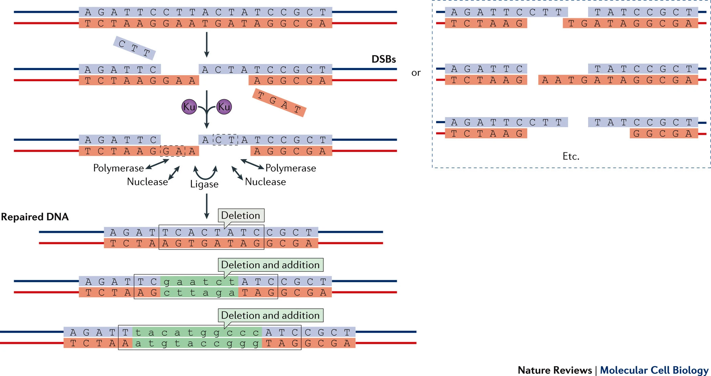{fig-align="center"}

:::notes
- Another mechanism is non-homolgous-end joining
- When DNA broken, then imperfectly repaired
:::

## Chronic myeloid leukemia fusion

:::{.small}
:::{.center}
- NHEJ SV hypothesis (minimal breakpoint homology)
- Recurrency hypothesis: CHR9 and CHR22 regions are physically close

:::
:::

:::notes
- For example, in chronic myeloid leukemia, the tumor driving fusion BCR-ABL is hyp. to be from NHEJ
- Although NHEJ is not typically recurrent, the hypothesis is that CHR9 and CHR22 gene regions are physically close, and suscetible to abnormal repair deriving a fusion event
:::

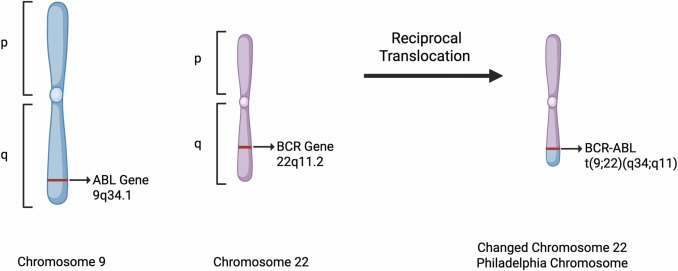{fig-align="center"}

## NHEJ example

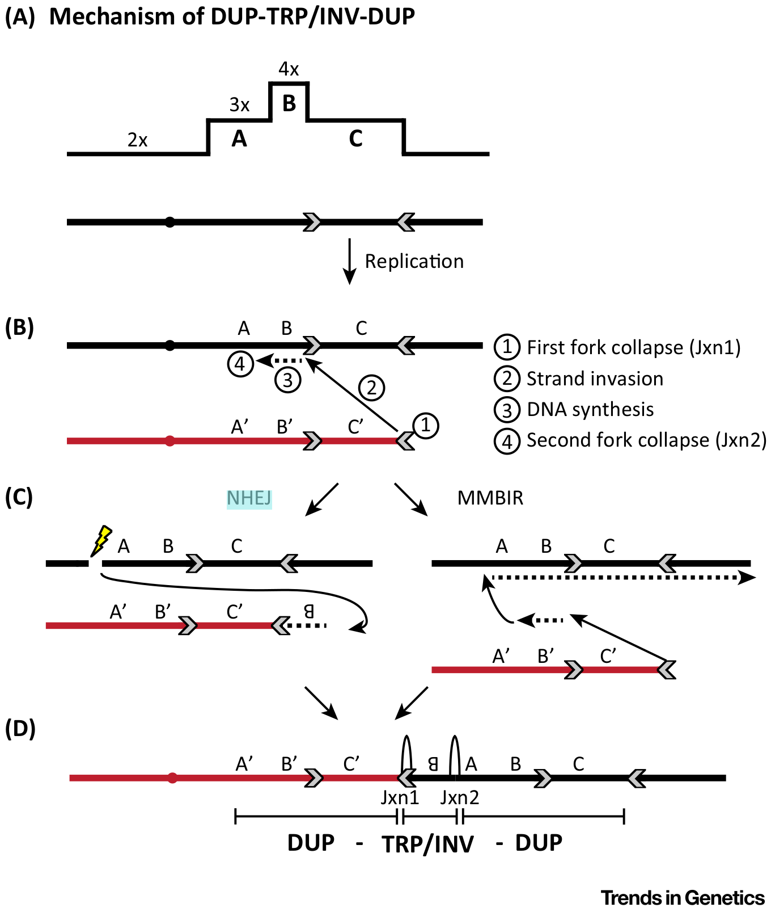{fig-align="center"}

:::notes
- A common complex SV formed by NHEJ is a DUP, TRP, DUP event when a replication fork collapses unexpectedly during DNA synthesis
- 1) one replication fork collapses
- 2) the loose end invades another replication fork 
- 3) synthesis begins again
- 4) The second replication collapses and a dsDNA break occurs
- finally, synthesized strand invades the break producing a large copy number gain

:::

## NHEJ summary

 

:::{.center}

- Imperfect repair of double strand DNA break
- Minimal homology at breakpoints
- Example: BCR-ABL1 fusion CML
- *Usually* low recurrency

:::

## Break-induced replication (BIR)

 

 

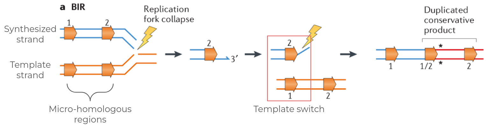{fig-align="center"}

<!-- from Mechanisms underlying structural
variant formation in genomic disorders -->

:::notes
- Replication fork collapses
- Abnormal loose end of synth. strand
- Template switch over to previous repeat copy
- Result is a duplication
:::

## Fork stalling and template switching (FoSTeS)

:::{.center}

Template switching during replication

 

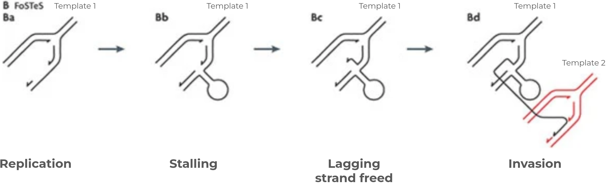{fig-align="center"}

:::

:::notes
- Replication
- Stalling (e.g., secondary structure)
- Lagging strand frees
- Invades another replication fork
:::

## SV mechanisms

 

:::{.small}
:::{.center}

| Mechanism | When | Recurrency | Breakpoint homology | Ex. pathology |
| ----- | ----- | ----- | ----- |
| NAHR | Recombination | Relatively high | Large | Smith–Magenis syndrome; DEL on CHR 17, RAI1 gene |
| NHEJ  | Repair | Low | None or small | Chronic Myeloid Leukemia; FUSION of BCR-ABL genes |
| BIR | Replication | Low | Small | Temple syndrome; DEL on CHR 14 |
| FoSTeS | Replication | Low | Small | Pelizaeus-Merzbacher; DUP CHR X, PLP1 gene | 

:::
:::

::: notes
- In summary, NAHR characterized by recurrent events and large breakpoint homology
- Other mechs have low recurrency, homology, and occur during repair or replication

:::

<!-- - NAHR pathology: Mechanisms underlying structural variant formation in genomic disorde
- BIR pathology: https://www.nature.com/articles/s41594-025-01644-z#Sec5 table1
- NHEJ pathology: Distinct pattern of genomic breakpoints in CML and BCR::ABL1-positive ALL: analysis of 971 patients
- FoSTeS pathology: https://pmc.ncbi.nlm.nih.gov/articles/PMC2685756/ -->

## SV mechanism research gaps

 

:::{.center}

1. Calling dependent SVs
2. Calling SVs using sequencing and mechanism models jointly
3. Mechanism-pathology association

:::

:::notes
- Revisting research gaps,
- SVs are not indepdendent
- Often treated independent during calling
- Post-hoc analysis resolves dependence
- Second, calling SVs based on mech models (e.g., breakpoint homology) may increase precision
- Third, quantifying association of mech. and path. would help us understand disease causes
:::

## Dependent SVs and mechanisms

:::{.center}
:::{.small}
- A single NHEJ event may produce multiple SVs
- NAHR rarely produces insertions
- Breakpoint sequence could rule out SV dependence
  - E.g., INS+DEL with large homology at DEL breakpoints
:::

{fig-align="center" width="55%"}

:::

:::notes
- As we saw, a single NHEJ event may produce multiple SVs
- NAHR has characteristic homology and SV types
- Although, it would be challenging to resolve NHEJ, BIR, and FoSTeS solely on breakpoints since they all have low homology
:::

## Dependent SVs as "Complex SVs"

:::{.center}
Severus

:::{.small}

- Breakpoint coordinates used for merging
- Breakpoint sequence not leveraged for resolving complex SV

:::
:::

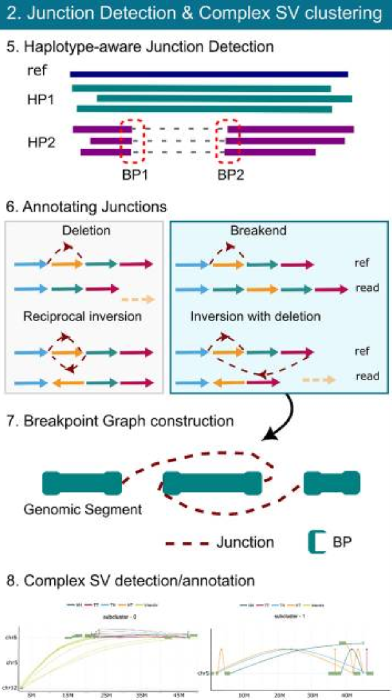{fig-align="center" width="50%"}

:::notes
- An existing tool for resolving dependent SVs is severus,
- However, it only uses breakpoint position not sequence
:::

## Severus complex SVs

:::{.center}
Annotates a pre-defined set of complex SVs
:::

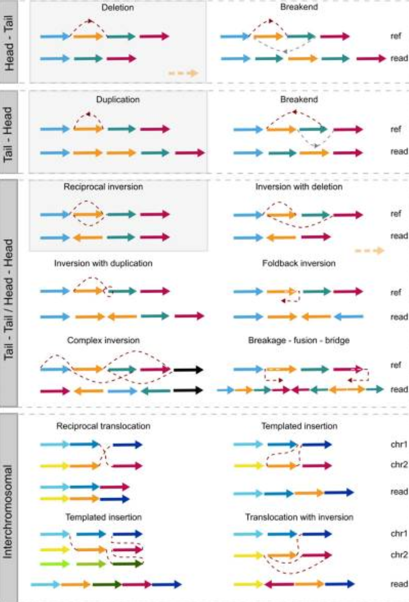{fig-align="center"}

:::notes
- Severus is also limited to a pre-defined set of complex SVs
:::

## Many coordinates clusterers

:::{.center}
:::{.small}

Breakpoint sequence not leveraged
:::

::::{.columns}
:::{.column width="50%"}
 
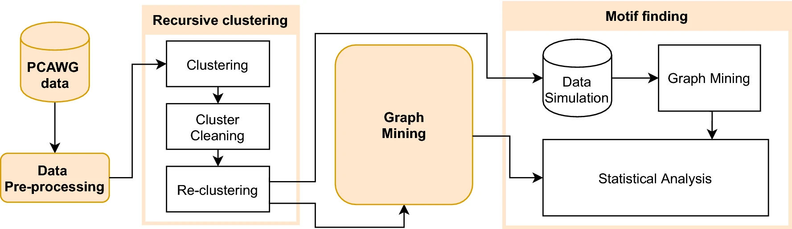{fig-align="center"}
:::
:::{.column width="50%"}
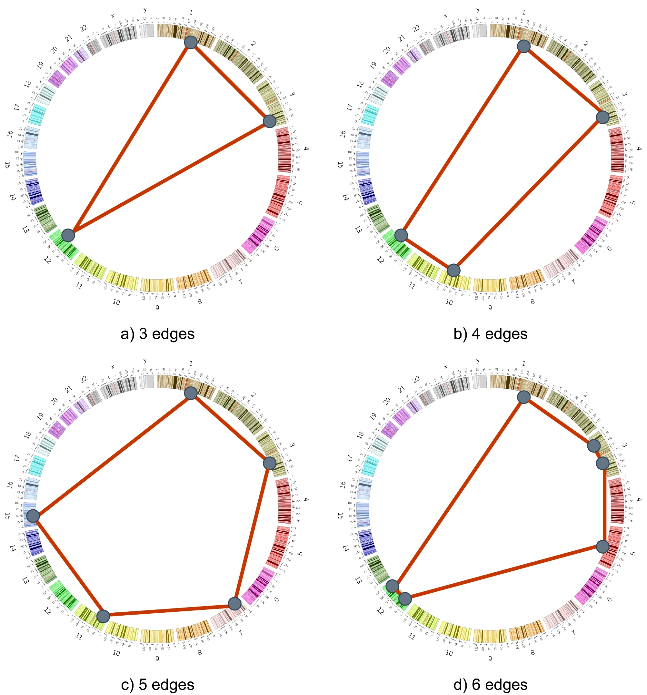{fig-align="center" width="70%"}
:::
::::

:::

:::notes
In general, current complex/dependent SV finders use breakpoint positions solely, not brekapoint seq or mechanistic models.
:::

# SVs in human population

## Population SV analyses

 

:::{.small}
:::{.center}

| Paper | Cohort size | Variants | Objective |
| ----- | ----- | ----- | ----- |
| gnomAD | 125,748 exomes & 15,708 genomes | SNV, INDEL, & SV | Quantify gene mutation constraint | 
| 1KG short read | 2,504 genomes | SV | Build diverse human SV set | 
| 1KG long read | 1,019 genomes | SV | Improve human SV set quality via longer reads and graph reference genome |

::::{.columns}
:::{.column width="50%"}
{width="40%"}
:::
:::{.column width="50%"}
{width="40%"}
:::
::::

:::
:::

:::notes
- 3 major studies
- gnomAD largest, focus on SNVs and genes constrained to variation
- 1KG
- 2 papers: i) short-read more samples and ii) long-read less samples
- paper 1 was about SV set construction and description
- paper 2 was about analysis using both linear and graph genomes
:::

## Population SV findings

 

:::{.small}
:::{.center}

| Paper | Cohort size | Variants | Major finding |
| ----- | ----- | ----- | ----- |
| gnomAD | 125,748 exomes & 15,708 genomes | SNV, INDEL, & SV | Some genes essential, others dispensable | 
| 1KG short read | 2,504 genomes | SV | Establish & describe global SV reference set | 
| 1KG long read | 1,019 genomes | SV | Mobile elements SVs largely impact genome |

<!-- ::::{.columns}
:::{.column width="50%"}
{width="50%"}
:::
:::{.column width="50%"}
{width="50%"}
:::
:::: -->

:::
:::

:::notes
- the major findings, imo, are
- gnomad: some genes essential, others dispensible
- 1kg sr: describe SV set from multiple ancestries
- 1kg lr: mobile element SVs impact human genomely largely
:::

## Research gaps

:::{.center}
1. Mobile element detection and inspection
2. Low VAF specialized analysis
:::

:::notes
- Research gaps relative to pop. SV analysis
- Mobile elements cause a significant amount of SVs, yet majority of callers focus on DELs and copy number variants
- Experimental wesults were often sensitive to low VAF.
- Correcting for and addressing low VAF SVs is important since rare SVs are more likley to be pathogenic than common SVs
:::

## gnomAD

:::{.center}
:::{.small}

Sections

1. Dataset description
2. Negative selection for LoF variants
3. LoF-disease association
:::
:::

::::{.columns}
:::{.column width="33%"}
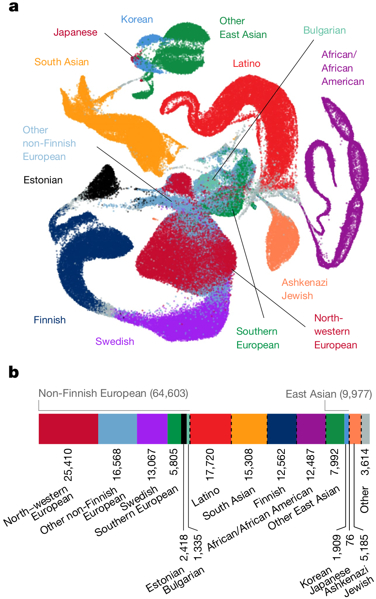{width="60%"}
:::
:::{.column width="33%"}
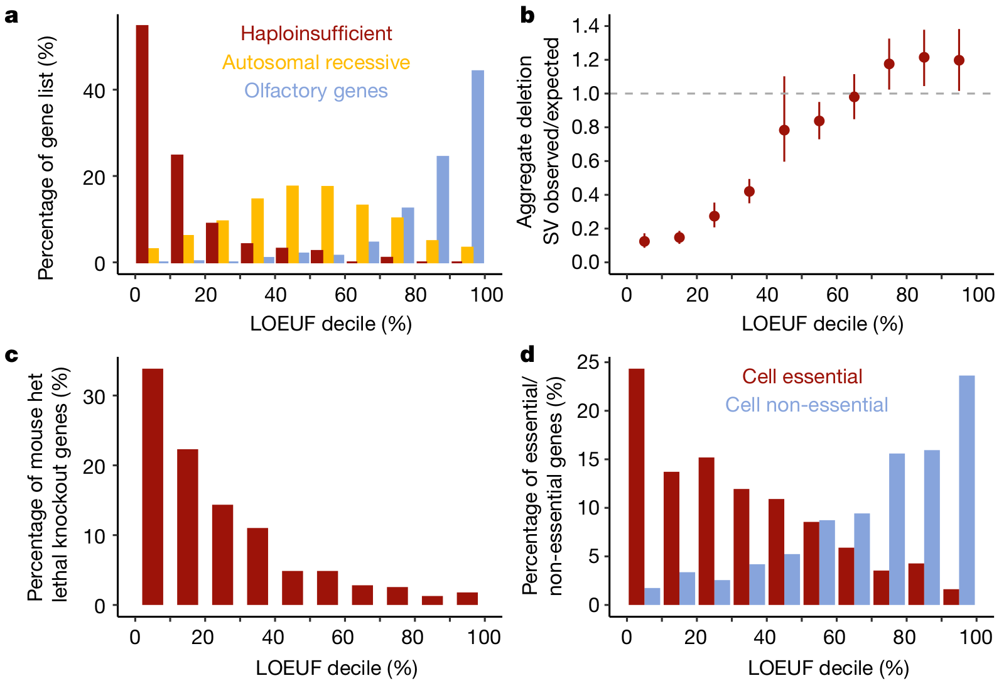{width="100%"}
:::
:::{.column width="33%"}
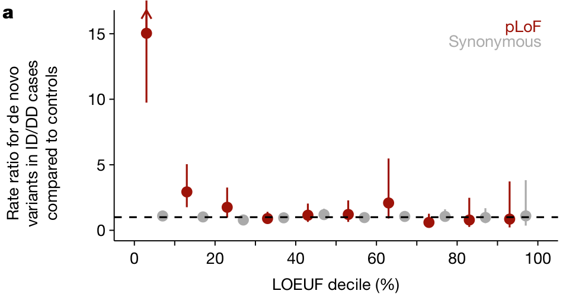{width="100%"}
:::
::::

:::notes
- Begin dataset description
- Show negative selection for protein loss of func. variants
- Show association of pLoFs and disease
:::

## Sample geography

:::{.small}
:::{.center}

- 125,748 exomes & 15,708 genomes
- EUR biased

{fig-align="center" width="20%"}

:::
:::

:::notes
- Most samples were exome seq.d 
- About 10% were whole genome seq.d
- The cohort was biased to EUR ancestry
:::

## Genome v exome

 

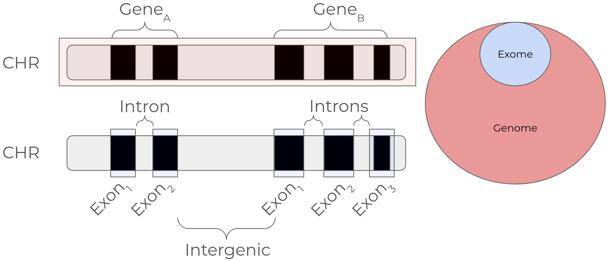{fig-align="center"}

:::notes
- Quick note
- WGS covers all base pairs
- Exome typically covers only exons
- However, their exon samples also seemed to include introns, as we will see
:::

## SNVs

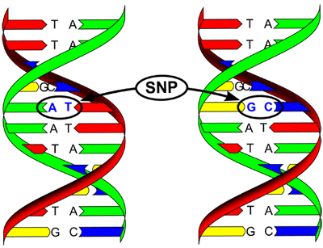{fig-align="center"}

:::notes
- Another quick note:
- gnomad focuses on snvs moreso than SVs
- these are just single base substitutions
:::

## SNV-element overlap

::::{.columns}
:::{.column width="50%"}

:::
:::{.column width="50%"}
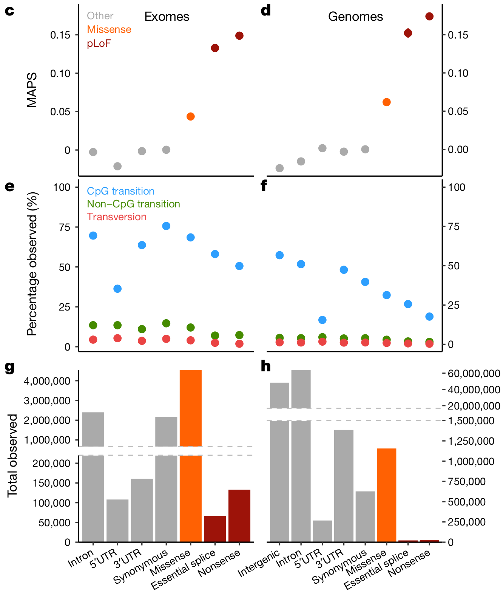{fig-align="center" width="90%"}
:::
::::

::: notes
- They show i) splice site and nonsense mutations are relatively rare (gh) 
- because ii) they are most likely to cause loss of function (cd).
:::

## SNV-element overlap

::::{.columns}
:::{.column width="50%"}

:::{.small}
- Missense: changes codon -> changes protein sequence
- **pLoF**: predicted loss of function
- **MAPS**: mutability adjusted proportion of singletons
- CpG transition: CG -> TG
- Transversion: Purine (GA) <-> Pyrimidine (CT)

:::

:::
:::{.column width="50%"}
{fig-align="center" width="90%"}
:::
::::

::: notes
- This was quantified using MAPS: mutability adjusted proportion
- Some other acronyms and terms:
- Missense: SNV changes codon and protein seq.
- pLoF: predicted loss of function
- CpG: special type of SNP
- Transversion is when purine base changes to pyrimidine or vice versa
:::

## MAPS intution

:::{.center}
Is SNV functional class enriched with rare (singleton) events?
:::

{fig-align="center" width="90%"}

:::notes
- goal of MAPS metric is to test if an SNV func. class enriched with singleton events
- If a class is more rare than expected, then it is constrained
:::

## MAPS

:::{.center}
:::{.small}

- MAPS: Mutability adjusted proportion of singletons
- Aggregate singletons within SNV functional classes (e.g., pLoF or missense)
- MAPS $\approx$ Observed singleton prop. $-\text{ }f$(expected singleton prop.)
- MAPS > 0: more singletons observed than expected
<!-- - Expected: derived from non-coding regions, weighted by mutation rate (freq.) -->

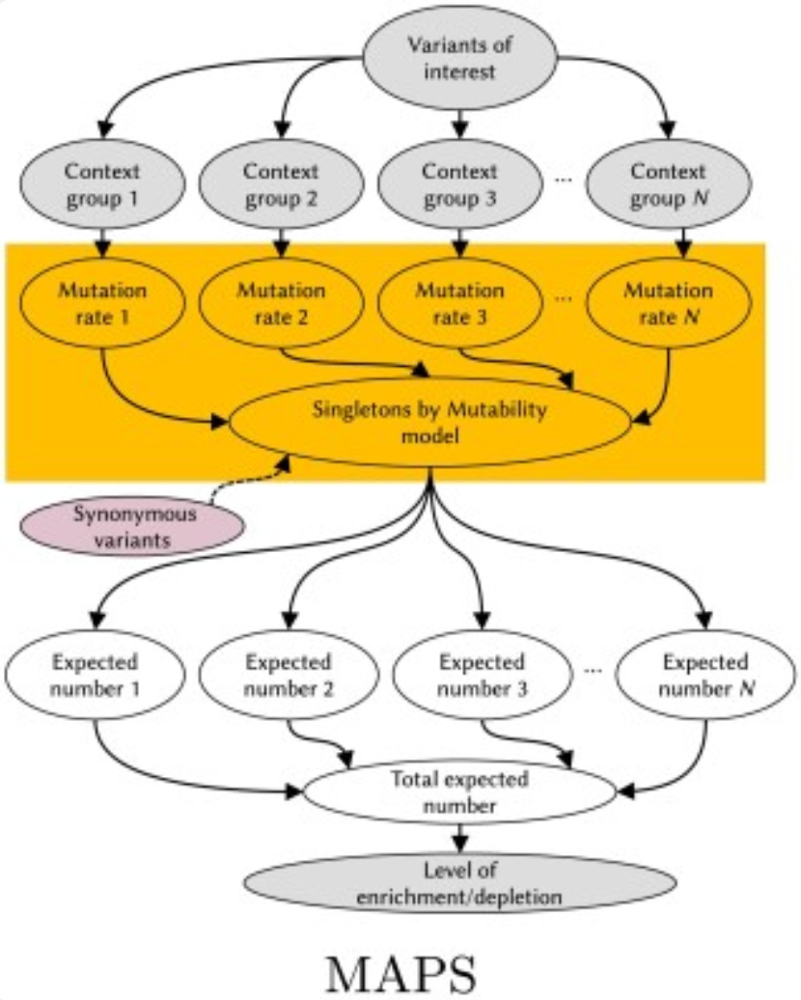{fig-align="center" width="20%"}

:::
:::

:::notes
- MAPS: Mutability adjusted proportion of singletons
- Aggregate singletons within SNV functional classes (e.g., pLoF or missense)
- MAPS > 0: more singletons observed than expected
- Expected is estimated from non-coding regions and weighted by SNP mutation rates
:::

## pLoF negative selection

:::{.center}

pLoF mutation rates are constrained to be rare 

{fig-align="center" width="30%"}

:::

:::notes
- So, in summary the high MAPS value showed that LoF variants are constrained to be rare
:::

## LoF annotation-based filtering

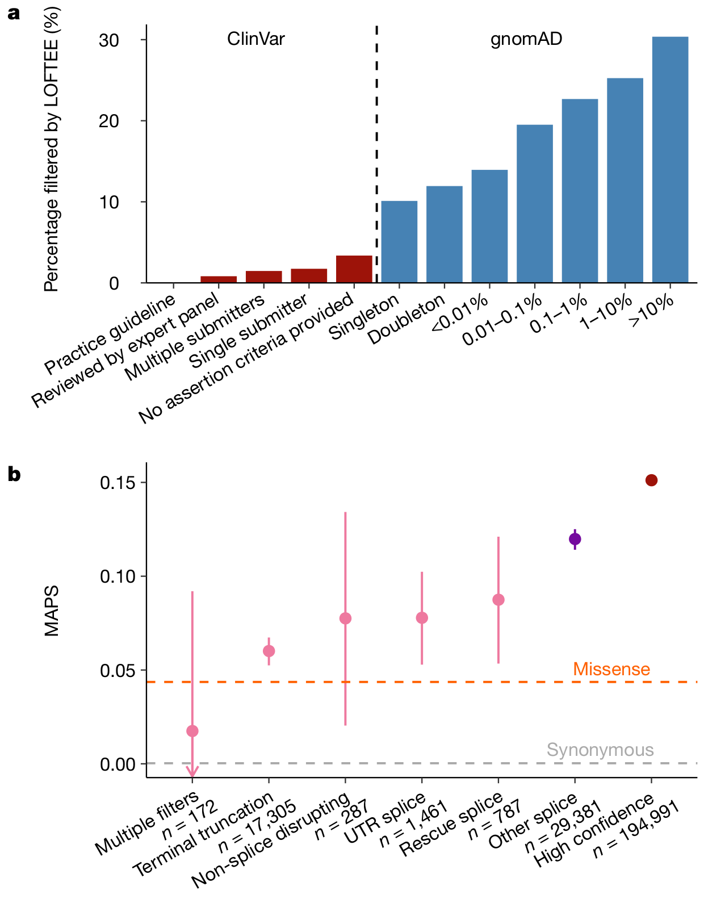{fig-align="center"}

::: notes

- They developed an annotation-based filter for loss of function variants,called LOFTEE
- Example annotation filters: UTR splice site would not affect the protein seq.
- In summary, LOFTEE filtering agrees with ClinVar annotations and observed AF
- That is, higher AF were more likely to be filtered out as non LoF variants

:::

## RNA-splicing

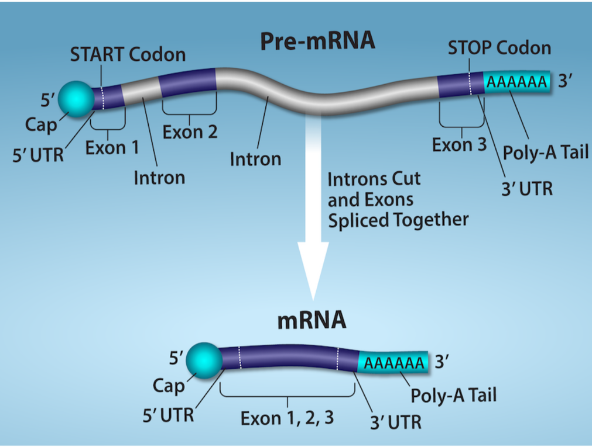{fig-align="center"}

:::notes
- Another side note
- UTRs & introns are gene regions that are spliced out and not in final protein
:::

## pLoF SNVs emprically under-observed

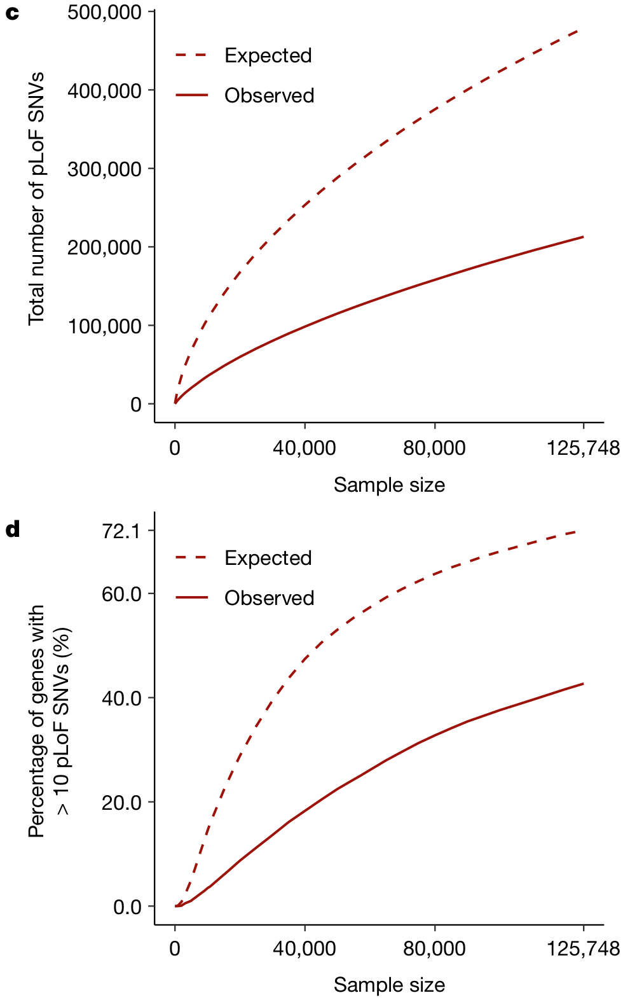{fig-align="center" width="50%"}

:::notes
- They computed the number of LoF variants at different sample subset sizes
- Found that LoFs were much less common than expected by random chance
- Both in terms of total count and percent of genes with > 10 LoF SNVs
:::

## pLoF functional consequences

{fig-align="center" width="50%"}

:::notes
- Using their cohort, they developed statistical metric to rank genes constrained to LoF variants
- When applied, the metric isolated essential genes and non-essential genes (like olfactory genes)
:::

## LOEUF

:::{.small}
:::{.center}

- LOEUF: Loss-of-function observed expected upper bound fraction
- Goal: mesaure intolerance to pLoF
- Approach: score genes by pLoF SNV proportion
- Metric: #Obs. pLoF SNVs / #Exp. pLoF SNVs; take upper bound CI

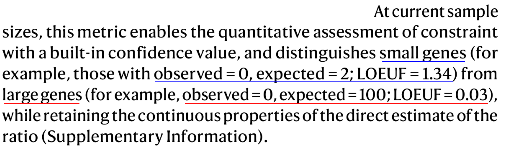{fig-align="center"}

:::
:::

:::notes
- LOEUF metric is "Loss-of-function observed expected upper bound fraction"
- Goal: mesaure intolerance to pLoF
- approach: score genes by pLoF SNV proportion
- value: #Obs. pLoF SNVs / #Exp. pLoF SNVs; take upper bound CI
- A lower value implies a gene constrained to not have LoF variants
- The confidence interval allows better resolution for small and large genes, such as the example in text
:::

## Constrained genes PPI and expression

::::{.columns}
:::{.column width="50%"}

:::{.center}

 

$\downarrow$ LOEUF $\rightarrow$ $\uparrow$ PPI 

 

 

$\downarrow$ LOEUF $\rightarrow$ $\uparrow$ tissue expression coverage
:::

:::
:::{.column width="50%"}
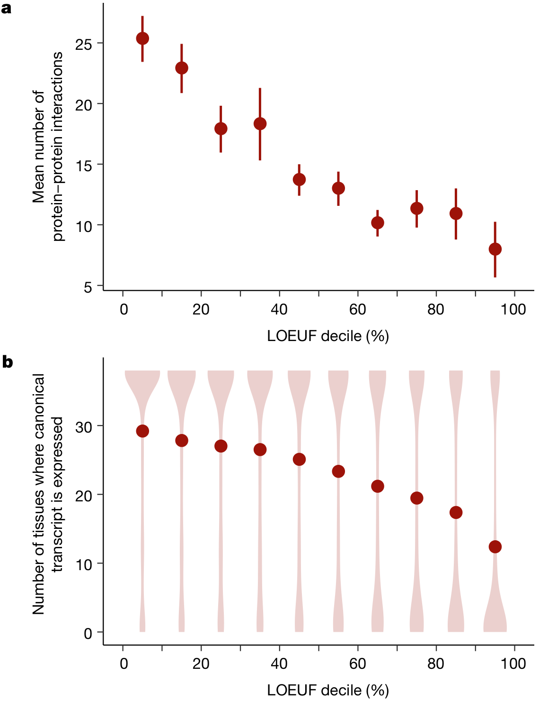{fig-align="center" width="55%"}
:::
::::

:::notes
- Genes with high PPI or expression coverage across tissues were more constrained against LoF variants
:::

## Transcript expression bias

 

:::{.center}
Constrained RNA isoforms are highly expressed
:::

::::{.columns}
:::{.column width="50%"}
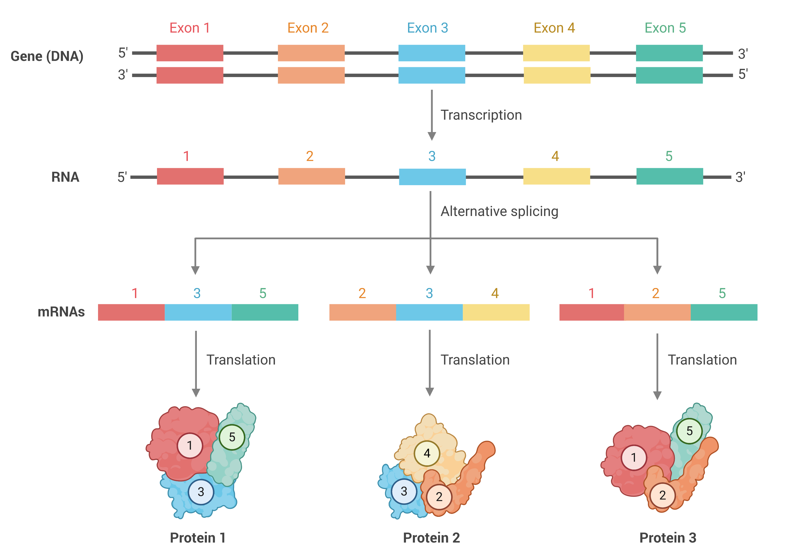{fig-align="center"}
:::
:::{.column width="50%"}
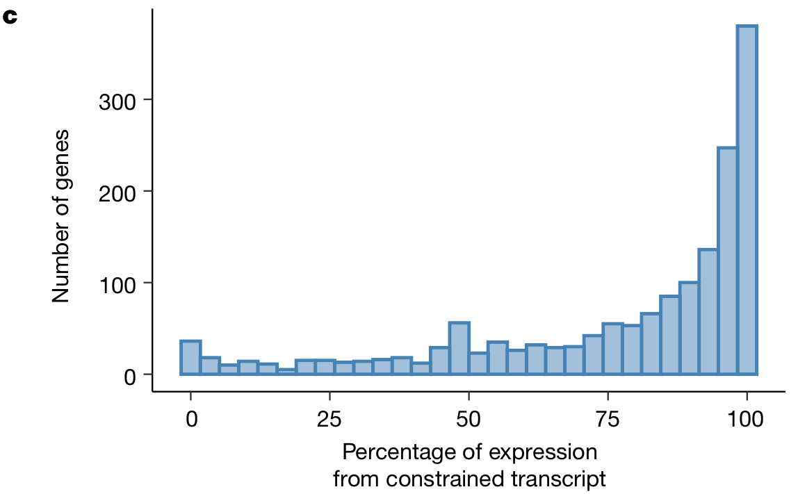{fig-align="center"}
:::
::::

::: notes
- For each gene with >=1 constrained and >=1 unconstrained isoform, they measured expression fraction of constrained transcript
- Constrained RNA isoforms had greater expresssion
:::

## How apply mutational constraint metrics?

 

:::{.center}

- Diseases/traits are enriched with constrained pLoF variants?
- Relationship of heritability and mutational constraint?
:::

:::notes
- Okay, so how do you apply mutation metrics to study disease?
- Well, they asked 
- Are diseases/traits enriched with constrained pLoF variants?
- Is there a relationship of heritability and mutational constraint? 
:::

## De novo pLoF SNVs in disease

:::{.center}
:::{.small}

- Rate ratio: #Disesase de novo SNVs / #Control de novo SNVs

{fig-align="center" width="60%"}

:::
:::

:::notes
- Using a rate ratio: # Dis. de novo SNVs / # Control de novo SNVs
- Found that,
- More de novo LoF variants occured in constrained genes for developmental/intellectual disability cases compared to control
:::

## Trait inheritance LOEUF association

:::{.center}
:::{.small}
- Partitioning heritability enrichment
  - \> 1 $\rightarrow$ trait heritability explained by SNVs greater than random chance

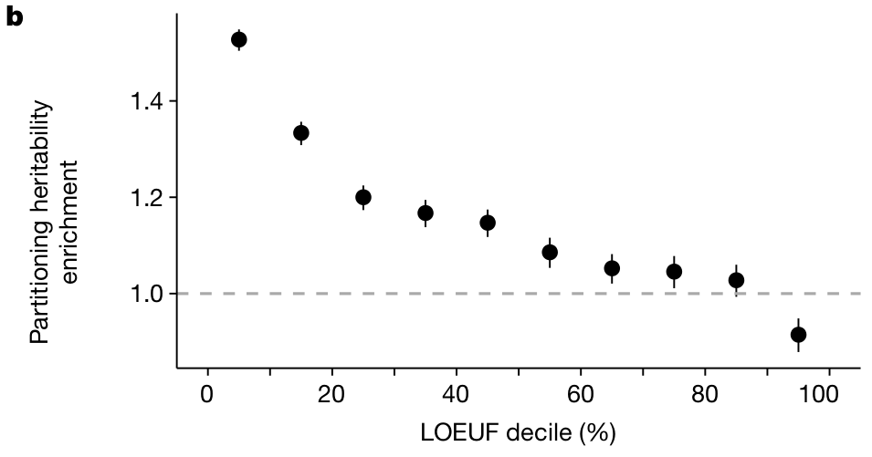{fig-align="center" width="70%"}

:::
:::

:::notes
- For trait heritability,
- They compared LOEUF to partitioning heritability enrichment
- heritability enrichment >1 implies trait heritability explained by SNVs is greater than random chance
- Again, the heritability metric is larger for low LOEUF genes
:::

## Trait pLoF SNV association

:::{.center}
:::{.small}
- Null: is trait NOT associated with pLoF variants?
- Schizophrenia and educational attainment previously reported as pLoF associated

:::
:::

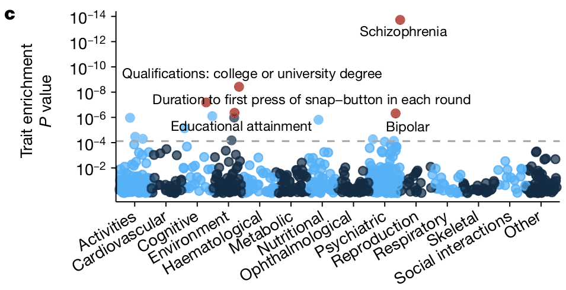

:::notes
- Finally, they tested for trait enrichment of pLoF variants
- Roughly, the null hyp. is that a trait is not associate with LoF variants
- When applied to an external cohort,
- They found that traits like schizophrenia and educational attainment were sig. associated
- Agreeing with previous findings
:::

## gnomAD summary

:::{.center}
:::{.small}
1. Massive exome dataset, yet biased to EUR ancestry
2. Modeled mutational constraint by pLoF proportion metric (LOEUF) 
3. LOEUF metric aligned with fundamental biology and diseases
:::
:::

::::{.columns}
:::{.column width="33%"}
{width="60%"}
:::
:::{.column width="33%"}
{width="100%"}
:::
:::{.column width="33%"}
{width="100%"}
:::
::::

:::notes
1. Massive exome dataset, yet biased to EUR ancestry
2. Modeled mutational constraint gene-wise by pLoF proportion metric (LOEUF) 
3. LOEUF metric aligned with fundamental biology and disease understanding
:::

## 1KG sections

:::{.center}
Sections

1. Introduce SV callset
2. SV element overlap
3. SV association with GWAS SNPs and expression
4. Complex SVs and breakpoints
:::

::: notes
- Next the short-read thousg paper
- First, introduce SV callset
- Second, quantify SV element overlap
- Third, measure SV association with GWAS SNPs and expression
- Fourth, investigate complex SVs and their breakpoints

:::

## 1KG SV summary

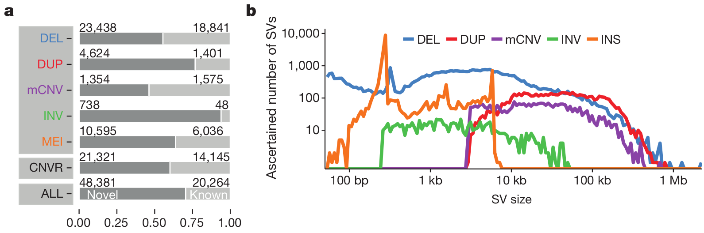{fig-align="center"}

::: notes
- The main findings include
- i) most SVs were not in a large prior callset
- ii) INVs rare relative to copy number variants
- iii) Length of SVs discovered was constrained by tool(-parameters)
:::

## SV callers

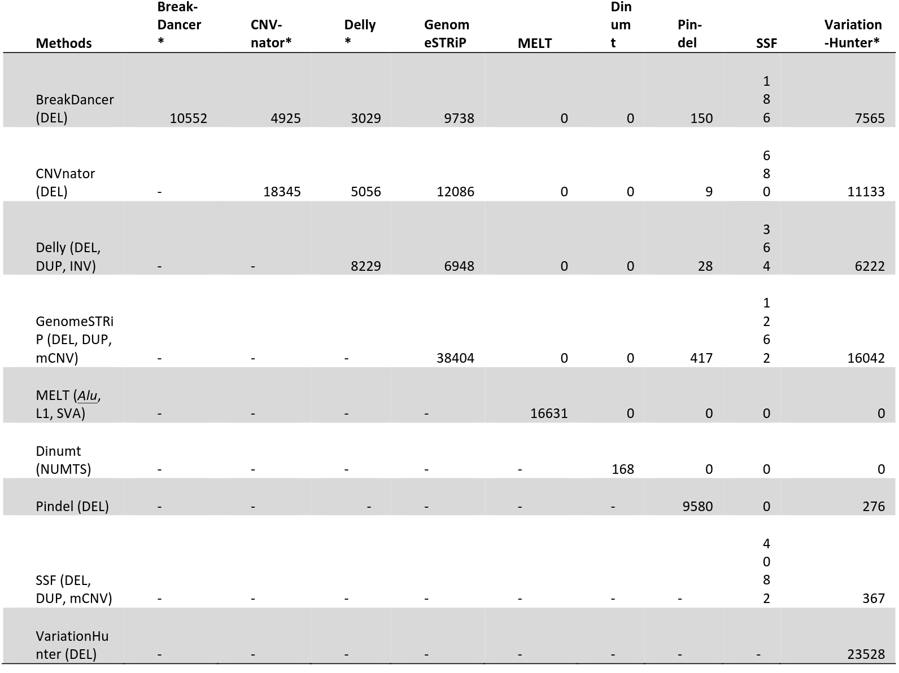{fig-align="center"}

:::notes
- Many DEL callers
- Only 1 INS caller, yet many MEIs called: ~16k
:::

<!-- | Caller | SV type | SV len. range | 
| ----- | ----- | ----- |
| BreakDancer | DEL | (50,$10^6$) |
| Delly | DEL, DUP, & INV | ? |
| VariationHunter | DEL | ? |
| CNVator | DEL | ? |
| Read-depth (SSF) | DEL, DUP, mCNV |
| Genome STRiP | DEL, DUP, mCNV |
| Pindel | DEL |
| MELT | MEI |
| Dinumt | NUMT | -->

## DEL breakpoint accuracy

:::{.center}
:::{.small}
- "True" breakpoints: assembly (TIGRA) and long-reads (PacBio)
- Low VAF SV breakpoints less accurate
- Pindel accuracy; likley due to split-read reliance
:::
:::

:::notes
- Breakpoint accuracy was evaluated using assembled contigs and long-reads
- They found low VAF SV breakpoints were less accurate
- Pindel tool had high accuracy; it uses split read evidence only which always includes the junction sequence
:::

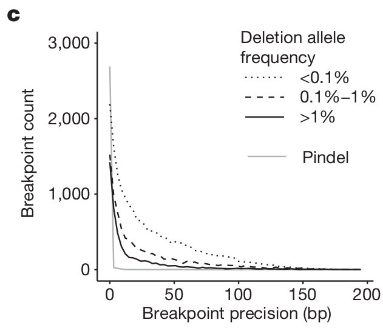{fig-align="center" width="70%"}

## Discordant v split reads

 

:::{.center}
Split reads include breakpoint sequence
:::

 

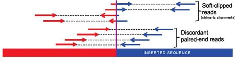{fig-align="center"}

:::notes
- A side note on discordant v split reads
- Split reads include the breakpoint sequence
- Discordant reads do not necessarily
:::

## SV ancestry

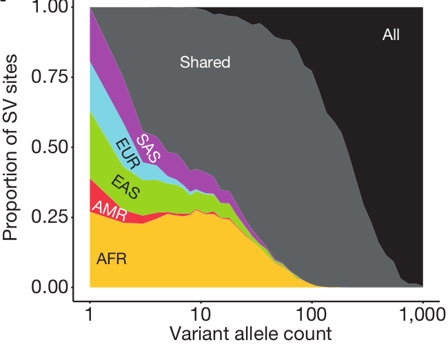{fig-align="center" width="70%"}

::: notes
- For ancestry,
- Many SVs are present in > 1 continental ancestry
- Some relatively common SVs (e.g., AC > 10 ) are present solely in AFR population; this population-distinctness is not observed for other pops.
:::

## SV SNP LD

:::{.center}
:::{.small}

- **LD**: linkage disequilibrium
  - $r^2 \approx 1 \rightarrow$ non-random co-occurence
  - $r^2 \approx 0 \rightarrow$ random co-occurence
- Here, LD measured for SVs and nearby SNPs

:::
:::
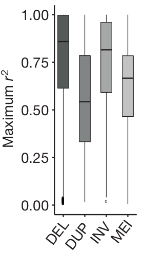{fig-align="center" width="70%"}

:::notes
- Using the linkage disequilibrium metric, they measured co-occurence stats for SVs and nearby SNPs
- If r sq. is high this implies correlation or non-random co-occurence
- Low implies co-occurence seems random
:::

## SV element overlap

- Expected: shuffled SVs intersecting with true elements
- Approaches: i) partial overlap and ii) engulf overlap

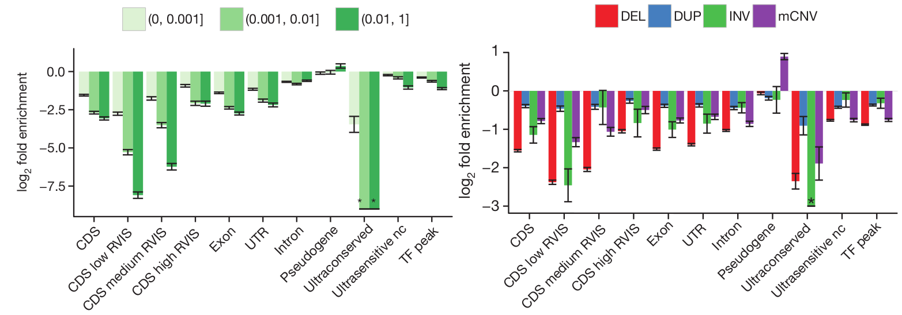{fig-align="center"}

:::notes
- Next, they analyzed the overlap of SVs and genomic elements
- The expected overlap was computed by shuffling SVs while keeping other elements in-place
- Their supp. methods described two ways to count overlap
- i) partial overlap or
- ii) engulf overlap
:::

## Partial v enguled overlap

 

 

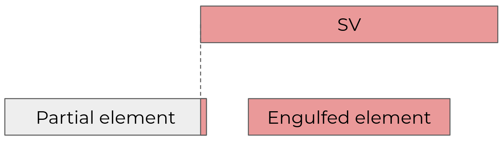{fig-align="center"}

:::notes
- Partial overlap requires only 1 bp overlap
- Engulf overlap requires the entire element to be contained in the SV
- For the following results, partial overlap is reported
:::

## SV partial element overlap

- Log enrichment: $<0 \rightarrow$ less overlap than expected
- RVIS: residual variation intolerance score (functional variant intolernace)
  - $\uparrow RVIS \rightarrow$ $\uparrow$ variant tolerance

{fig-align="center"}

:::notes
- The log obs./exp. was computed for various elements
- Another important stat is RVIS: measuring functional variant intolerance
- In summary,
- and left fig.: lower VAF -> higher chance of element overlap
- right: DELs are usually more constrained than other SV types
- in general, constrained regions were negatively enriched with SV overlap
:::

## SV expression association

:::{.center}
:::{.small}

- DUSP22: sig. eQTL variants overlaps TSS and coding seq.
- ZNF43: sig. eQTL variants are upstream coding seq.

:::
:::

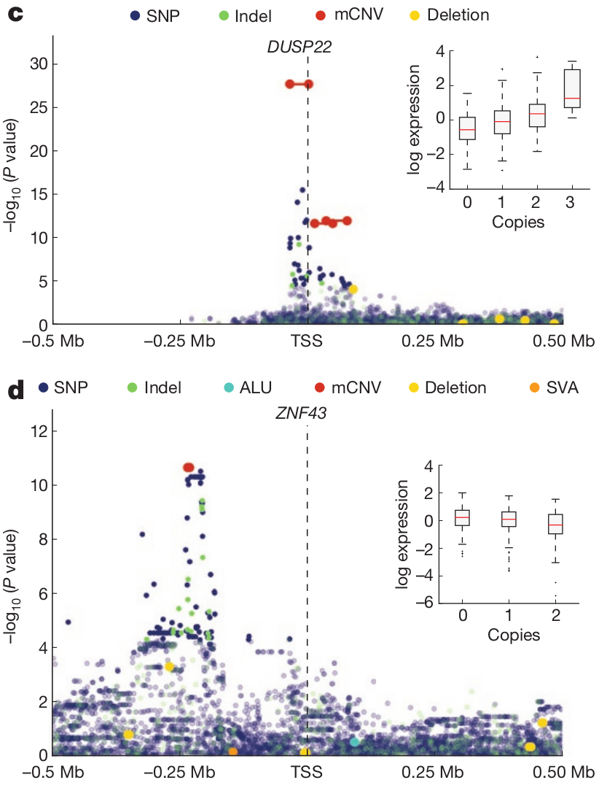{fig-align="center"}

:::notes
- For SV-expression association, eQTL was used
- They noticed it was possible for lead eQTL variants to be either
- i) at TSS or (top)
- ii) some small distance away from TSS (bottom)
:::

## SV expression association

:::{.center}
:::{.small}

- eQTL: expression quantitative trait loci
  - Null: no association of SV and gene expression
  - $\downarrow p \rightarrow$ SV associate with gene expression change

:::
:::

{fig-align="center"}

:::notes
- Briefly, eQTL null is essentially that there is no assication of an SV and gene expression
:::

## LD of lead eQTL SNPs and SVs

:::{.small}
:::{.center}
- Hypothesis: sig. GWAS SNPs associated with SVs
- Denom: # expected SVs in LD with lead eQTL
  - Swap SV into another SV region with similar properties (e.g., VAF)
  - Restrict LD search space to +/- Xbps from TSS
  - Constrain haplotype length ($r^2$ [$\downarrow r^2 \rightarrow \uparrow$ haplotype len.])
  - Is lead eQTL SNP in haplotype length? (yes $\rightarrow+1$)
:::
:::

:::notes
- They tested for enrichment of SVs in LD with lead eQTL
- Found that constraining the haplotype length (r sq.) lead to larger enrichment
- They also observed larger enrichment in larger SVs
- In summary, it's possible that traits associated lead eQTL SNPs may actually explained by SVs
:::

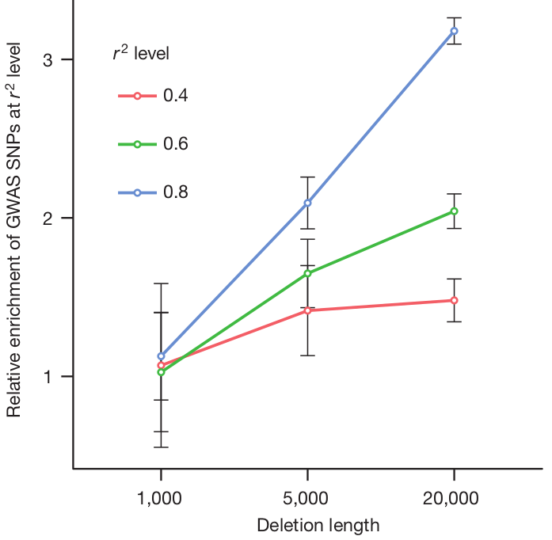{fig-align="center"}

## SV hotspots

 

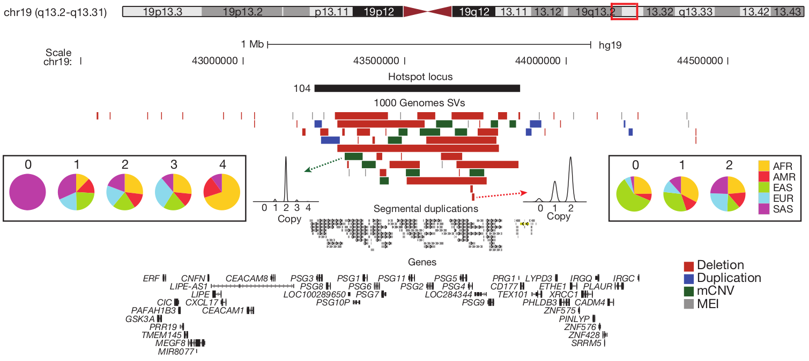{fig-align="center"}

:::notes
- What does an SV hotspot look like
- Here is an ~1Mbp region on CHR 19
- There's many SVs and there's many segmental duplications likely driving SV
- Surprisingly 13 genes intersect hotspot locus
- PSG: pregnancy specific glycoprotein; essential for healthy pregnancy
- Maybe the hotspot is overcome by redundancy
- mCNVs here have some ancestry bias for biallelic DELs

:::

## Complex SVs

{fig-align="center"}

:::notes
- Specific classes of complex DELs and INVs were counted
- Breakpoint sequences were analyzed
- Show what alignments look like for complex SVs
:::

## Complex DELs

{fig-align="center"}

:::notes
- Top 4 complex SVs look like repair/replication errors of DNA breakage due to small SVs inside a larger DEL. Or maybe, mobile element INS
- Most commonly DEL regions were filled with INS/DUP seq
:::

## Complex SV breakpoints

:::{.center}
- Red: junction seq. shared with breakpoint seq.
- Green: same as red, but reverse complement
- Blue: No similar neighboring seq. (INS)
:::

{fig-align="center"}

::: notes
- They show some complex SV breakpoints, and we can tell
- These are probably not NAHR because the homology is relatively small
:::

## Complex SV alignment

 

{fig-align="center"}

:::notes
- Left: DEL + INV
- Next: Del + rep. DUPs + INS
- Then: INV DUP
- Finally, an INV + repeat noise
:::

## DUPs are commonly INVerted

 

{fig-align="center"}

:::notes
- Interestingly, INV DUPs more common than simple DUPs
:::

## 1KG SV SR summary

:::{.center}
:::{.small}
- ~1/2 SV callset novel; samples less biased to EUR than gnomAD
- Negative selection for SVs overlapping conserved regions
- SVs association with trait SNPs (LD) and gene expression (eQTL)
- Complex SV classes recur with characterisitc breakpoint signatures
:::
:::

:::{.columns}
:::{.column width="25%"}
{fig-align="center"}
:::
:::{.column width="25%"}
{fig-align="center"}
:::
:::{.column width="25%"}
{fig-align="center"}
:::
:::{.column width="25%"}
{fig-align="center"}
:::
::::

:::notes
- In summary, 
- ~1/2 SV callset novel; samples less biased to EUR than gnomAD
- Negative selection for SVs overlapping conserved regions
- SVs association with trait SNPs (LD) and gene expression (eQTL)
- Complex SV classes recur some have characterisitc breakpoint signatures
:::

## 1KG SV LR sections

:::{.center}
Sections

1. Jointy analyzing SVs on linear and graph references
2. SV callset characteristics
3. Mobile elements
4. Breakpoint analysis
:::

::: notes
- Now, the long-read paper emphaisized
- joint analysis of SVs w.r.t linear and graph references
- again, summarize SV characteristic
- found mobile elements are highly active
- conclude with breakpoint analysis 
:::

## Geographical ancestry

 

:::{.center}
Mixed sample geography avoids common EUR bias
:::

{fig-align="center"}

:::notes
- Again, the 1KG cohort is well-mixed avoiding the common EUR ancestry bias in genomics
:::

## Long read (LR) depth and size

:::{.center}
:::{.small}
- ~16.9x median coverage
  - $\uparrow$ coverage $\rightarrow$ $\uparrow$ sensitivity to mosaic variants
- ~20.3kbp median read length
  - 100x larger than typical short-read
  - SVs can be contained in a single read
- LR is single-end, not paired-end
:::
:::

:::notes
- The read length here are about 2 orders of magnitude larger
- SVs can now be contained in a single read
:::

{fig-align="center"}

## Augmented graph SV analysis

:::{.center}

1. Align to 3 different references (GRCh38, CHM13, and HPRC)

:::{.small}
- Linear: GRCh38 and CHM13
- Graph: HPRC
:::
:::

{fig-align="center"}

:::notes
- A major discussion of this paper is how they jointly analyzed SVs over linear and graph references
- A graph reference uses forking paths to include more than 1 possible sequences
- First, they aligned samples to the 3 diff refs
:::

## Augmented graph SV analysis

:::{.center}

2. Call SVs

:::{.small}
- Linear: Delly and Sniffles
- Graph: SVarp
:::
:::

{fig-align="center"}

:::notes
- Next, they called SVs
:::

## Augmented graph SV analysis

:::{.center}
3. Create pseudo-haplotypes

:::{.small}
- Pool SVs by caller
- Create haplotypes such that no SVs overlap within haplotype
- Use bcftools consensus to resolve sequence
- Q: Beyond overlap, what criteria assign SVs to specific haplotypes?
:::
:::

| Caller | #Pseudo-haplotypes |
| :-----: | :-----: |
| Delly | 26 |
| Sniffles | 69 |
| SVarp | 117 |

<!-- {fig-align="center"} -->

:::notes
- They then created "pseudo-haplotypes" by 
- Pooling SVs by caller
- Assigned SVs to haplotypes such that no SVs overlap within haplotype
- bcftools consensus was used here
- I am curious what criteria beyond overlap was used to assign SVs to haplotypes since they are multiple possibilities if overlap alone was used
- The table shows the count of pseudo haplotypes per SV caller
:::

## Genotype v haplotype

:::{.center}
:::{.small}
- Genotype: which alleles present and how many?
  - Ex: A/A homozygous SNP at CHR4:123456bp $\rightarrow$ genotype = "1/1"
- Haplotype: which alleles physically linked on singular chromosome?
  - Ex: SNPs at bp 4 (C>A) & 7 (A>C)  are "phased" to same physical chromosome
:::
:::

{fig-align="center"}

:::notes
- A side note
- Genotype tell us which alleles are present
- A haplotype tells us which allele are physically linked together on a sinular CHR
:::

## Augmented graph SV analysis

:::{.center}
4. Inject pseudo-haplotype seq. paths
:::

 

{fig-align="center"}

:::notes
- Okay, next they add pseudo-haplotypes to the graph
:::

## Augmented graph SV analysis

:::{.center}
5. Genotype (Giggles) and phasing (SHAPEIT5)
:::

 

{fig-align="center"}

:::notes
- Finally, they genotype and phase SVs on the augmented graph
:::

## SV allele frequency

{fig-align="center"}

:::notes
- Similar to the short-read paper, they investigate AF by ancestry
- About a 1/4 of SVs are singletons
- About 1/2 are between AC>2 and AF < 50%
:::

## SV length

{fig-align="center"}

::: notes
- For SV length,
- Many SVs are smaller than read length
- Oh, the SV count for illumina was subsetted to long read samples
- Mobile element driven SVs are characterized by length peaks
:::

## Graph augment adds low VAF SVs

{fig-align="center"}

:::notes
- They also genotyped the graph before and after augmentation
- Augmentation added mostly low VAF SVs which intuitively makes sense
- If they were high VAF SVs, they would have likely already been represented in the graph
:::

## SV count by continent and GT

 

{fig-align="center"}

:::notes
- By continent, they counted num. hom/het SVs per individual
- AFR had highest SV count in both cases
- 2nd place swaps from EAS to AMR for HOM to HET
:::

## SV element overlap

 

{fig-align="center"}

:::notes
- Again similar to SR paper,
- most SVs not intersecting genes (intergenic)
- SV that did intersect coding seqs. had low allele frequency
:::

## Populaton mixing

:::{.center}
:::{.small}
- $F_{st}$: fixation index
  - $F_{st} \approx 0 \rightarrow$ SV AFs are consistent across continents
  - $F_{st} \approx 1 \rightarrow$ SV AFs are biased to given continent
:::
:::

::::{.columns}
:::{.column width="50%"}
{fig-align="center"}
:::
:::{.column width="50%"}
 
{fig-align="center"}
:::
::::

:::notes
- To measure mixing of continental ancestries,
- They used the fixation index in a one-versus-rest and fashion and found that
- AFR & EAS have relatively more SVs with AFs biased to their continent
:::

## SV sub-classes

:::{.center}
:::{.small}

- Classes resolved by SV annotator (SVAN)
- VNTR: variable number tandem repeat
- ALU: ~300bp mobile element

{fig-align="center"}

:::
:::

::: notes
- Looking at SV classes resolved by SV annotator,
- VNTR is most common SV class for both DEL and INS
- High MAF suggests these variants are common
- Aside from VNTR, most other SV classes have low AF
:::

## INV sub-classes

 

{fig-align="center"}

:::notes
- The INV sub-class analysis shows,
- again, INV DUP more common than simple INV, tend to be smaller than other INV types
- Overall, beyond mechanism and breakpoints, SV sub-classes have characteristic lengths and AF
:::

## L1 transduction activity

:::{.center}
:::{.small}
Transduction: element is copied and inserted elsewhere
:::

{fig-align="center" width="60%"}
{fig-align="center" width="40%"}

:::

:::notes
- Mobile element events were analyzed closely since they cause a large amount of variation
- For ex, L1: mobile element w/ characteristic ~6kbp length. includes a repeat region
- Takeaway: some mobile elements are more active than others and adjancent seq copied along is biased to the origin of element
- Tail transduction bias except for 3rd origin loci
- Not in GRCh38 nor CHM13 means it was in the graph genome
- Takeaway 2: Prior reports have many of these elements as "non-hot"/inactive, but they seem pretty active here
:::

## SVA transduction activity

:::{.center}

{fig-align="center" width="60%"}

 

{fig-align="center" width="30%"}

:::

:::notes
- Another common mobile element was SVA: SINE-VNTR-ALU composed of different elements
- SVAs are about 2-3kbp length elements
- Within element, there was a bias for head/tail transduction, but across elements was well-distributed
- Greater reference agreement compared to L1 activity
:::

## Singular 5' L1 transduction

::::{.columns}
:::{.column width="50%"}
 

:::
:::{.column width="50%"}

:::
::::

:::notes
- The only 5' L1 source was investigated a bit more closely
- Transduciton was slightly CHR biased and many events are near ends of chromosome
- Source strand is reverse. Slight bias to forward strand targets
:::

## L1 transduction alignment

{fig-align="center"}

:::notes
- When looking at the alignments in 21 samples,
- This L1 element is nearby a promoter and RNA-splicing may include the L1 element allow it to get transcribed, travel, and recombine elsewhere
- CAGE read counts measure TSS reads (RNA-seq)
:::

## Breakpoint analysis

 

{fig-align="center"}

:::notes
- BLAST was used to measure breakpoint homology
- Word size param is min. exact match
:::

## Breakpoint homology

{fig-align="center"}

:::notes
- Empirically, some SVs have characteristic lengths and breakpoint homologies: SDs and Alu do. VNTR not so much
:::

## Breakpoint homology

{fig-align="center"}

:::notes
- In general, homology by type agrees with mechanistic models
- Example NHEJ (dark gray) has small homologies
- SD (black) has large homologies; although these SVs are more rare
- Takeaway 2: many SVs detected are smaller than median read size (20.3kbp)
- Q: are smaller SVs more common or is this a technology bias?
:::

<!-- ## Recurrent ALU DEL

 

{fig-align="center"}

:::notes
- The final primary analysis investigated a recurrent ALU DEL
- Haplotypes clustering by SNPs occured in a 100kbp window
- Clusters were biased to continent: i) EAS, ii) AFR, iii) SAS
- DEL SV present in clusters 2 and 3 and 1 outlier sample
- "Recurrence-indicating" SNPs highlighted in red. Maybe LD?
::: -->

## 1KG SV LR summary

:::{.center}
:::{.small}
<!-- 1. Jointly analyzing linear and graph reference SVs -->
1. Genotyped and phased SVs using augmented graph
2. SVs lengths were generally smaller than read length
3. Mobile elements contribute ~1/3 total bp SV-driven variation in humans
4. Large variation in mobile elements
5. Breakpoint analysis agrees with mechanistic models
:::
:::

::::{.columns}
:::{.column width="33%"}

 

{fig-align="center" width="60%"}
:::
:::{.column width="33%"}

 

{fig-align="center" width="60%"}
:::
:::{.column width="33%"}
{fig-align="center" width="60%"}
:::
::::

## SVs in pop. summary

:::{.center}

- SVs and SNPs often dependent (high LD)
- SV location is constrained 
- Mobile elements frequently cause SVs
- Empirical breakpoints agrees with mechanistic hypotheses

:::

## SV-SNP dependence

::::{.columns}
:::{.column width="50%"}
{fig-align="center" width="50%"}
:::
:::{.column width="50%"}

 

{fig-align="center" width="50%"}
:::
::::

## SV location constraint

 

 

::::{.columns}
:::{.column width="70%"}
{fig-align="center"}
:::
:::{.column width="30%"}
{fig-align="center"}
:::
::::

:::notes
- SR: SVs in variation intolerant coding regions (low RVIS) were less than expected at random
- LR: total number of CDS altering SVs was lower than overlap with other elements
:::

## Mobile element SVs

 

{fig-align="center"}

## Empirical breakpoints match models

:::{.center}

{fig-align="center" width="80%"}

:::

:::notes
- Homology size of breakpoints depends on SV mechanism
:::

## SVs in pop. gaps

:::{.center}
1. Mobile element detection and inspection
2. Low VAF specialized analysis
:::

:::notes
- Mobile elements cause a significant amount of SVs, yet majority of callers focus on DELs and copy number variants
- Experimental wesults were often sensitive to low VAF. Correcting for and addressing low VAF SVs is important since rare SVs are more likley to be pathogenic than common SVs
:::

# SVs in cancer

## Research gaps

:::{.center}

1. Complex/clustered SV event detection
2. Developing, tuning, and using tools for specific cancer types

:::

:::notes
- Clustered SV events (chromothripsis) tend to occur early in cancer. Therefore, it is important to detect and understand these events
- As we will see, the driver variants vary heavily across tumor types. Yet, pan-cancer analysis is still a popular approach.
- To address heterogenity of different cancer types, developing tumor-specific tools, or tuning them to cancer types seems necessary.
:::

## PCAWG

:::{.center}
Sections

1. Variant caller evaluation
2. Driver mutations
3. Clustered variant events
4. Germline and somatic variant associations
5. Telomere mutations
:::

:::notes
- Sections are
- i) Variant caller evaluation 
- ii) Driver mutations 
- iii) Clustered variant event occurence and characteristics 
- iv)  Germline and somatic variant associations 
- v) Telomere mutations 

:::

## Variant caller evaluation

:::{.center}
For 50 samples, deep sequencing of target (variant-site) probes
:::

{fig-align="center"}

::: notes
- The pilot study evaluated variant calling in 50 samples
- For TP, they deeply sequenced and used fluorescence methods to confirm variants.
- Methods with good precision and recall (light blue) were selected for full study
:::

## Low VAF challenges

 

{fig-align="center"}

:::notes
- Importantly performance was sensitive to VAF
- Rare variants (low freq.) are hard to detect and false positives are common
- Intuitively, signal-noise ratio is smaller
:::

## Driver mutations

{fig-align="center"}

:::notes
- This plot takes a while to understand, but the summary here is that
- i) there are some outlier samples with large amount of SVs shown by the gray hist. colored sections are diff. tumor types
- second takeaway (bar): most patients have driver coding point mutation or somatic copy number variants
- GOTO NEXT
- angle separates samples
- outer:  sorted driver mutations per sample
- ii) Whole genome duplication presence (both homologous chromosomes are duplicated, could be just one pair)
- iii) Tumor type (color)
- iv) # driver CNVs
- v) # driver non-CNV rearrangements
- vi) # driver coding point mutations
- vii) # driver non-coding mutations
- viii) # Pathogenic germline variants
:::

## Gene driver variants

{fig-align="center"}

:::notes
- There are some notable driver genes
- Notable: TP53 is most common driver mutation, TERT also common (telomere repair)
- Notable: cis-activating GR (GR=genomic rearrangement) prostate only: ERG-TMPRSS2 dysregulation fusion
- Notable: fusion of BRAF gene in melanoma and CNS-piloastro
- altogether, many drivers deactivate tumor suppressing genes (TSG, light blue)
:::

## TSG DEL drivers

:::{.center}
TSG: tumor suppressor gene
:::

{fig-align="center"}

:::notes
- Many driver genes were biallelicly altered. dual full DEL was rare, but DEL+coding mutation was common
- Bottom value: # patients w/ bi-allelic mutation DIV total # patients w/ at least 1 allelic somatic gene mutation
:::

## Missing driver investigation

:::{.center}
- 4/181 driver-free samples had >5% normal contamination
- DeTiN tool re-analyzed and found drivers
:::

{fig-align="center"}

:::notes
- 181 samples did not have driver mutations, so they investigated this and
- i) some samples' drivers were rescued after addressing tumor-in-normal contamination (a)
- ii) for TERT-sensitive cancers many samples depth and purity was estimated insufficient to detect TERT mutations (bc)
- GOTO NEXT
- a) contamination measured by variant allele frequency difference in tumor and normal
- b) Estimated mutation detection sensitivity given purity and depth
- Again, this was only done for samples w/o drivers
- c) TERT detection sensitivity in cancers where TERT is commonly mutated

:::

## Chromothripsis v chromoplexy

:::{.small}
:::{.center}

{fig-align="center" width="50%"}

| SV | Chromosome(s) | Copy number change |
| ----- | ----- | ----- | ----- | ----- |
| Chromothripsis | 1 or few | Relatively high |
| Chromoplexy | Usually multiple | Relatively low |

:::
:::

:::notes
- A hallmark of cancer is clustered variant events: kataegis, chromoplexy, and chromothripsis
:::

## Clustered variant events

{fig-align="center"}

:::notes
- For panel a, there were a few main findings
- kataegies most common (clusters of SNPs)
- chromothripsis had high variance across tumor types
- most kataegis events were associated with APOBEC3 upregulation, except for lymphatic cancers
- For panel b, 
- neighboring kataegis events were relatively rare, but some occur near driver genes
- NEXT
- b: radius inv prop to dist of kataegis events
- b: each dot is a kataegis event and its radial location is the distance to next event (sequential)
- APOBE3B-type means up-regulated
:::

## Chromoplexy and chromothripsis

 

{fig-align="center"}

:::notes
- Neighboring chromoplexy events were even more rare than kataegis events
  - Fewer dots in shaded region
- and panel d) shows that, chromothripsis events with smaller avg breakpoint in the SV cluster tend to cause CNV of driver genes
  - Although the opacity of non-highlighted dots was quite low making it hard to confirm this trend
:::

## Sub-clonal events occur later

{fig-align="center"}

:::notes
- To understand timing of tumor mutations, 
- They analyzed clonality
- Clonal mutation: in most tumor cells
- Subclonal mutation: in subset of tumor cells
:::

## Clustered event timing

{fig-align="center"}

:::notes
- Kataegis usually happened later
- Chromothripsis tended to happen early and therefore may be an initial driver of cancer progression
:::

## Chromothripsis at driver genes

{fig-align="center"}

:::notes
- An example of chromothripsis in melanoma led to copy number gains of TERT (telomere repair) and CCND1 (promotes S phase)
:::

## Germline-somatic association

{fig-align="center"}

:::notes
- Next, they found only a few germline variants associated with somatic variants
- For example, a 30 kbp germline SV DEL on CHR22 known to increase breast cancer risk
:::

## BRCA1 PTV germline enriched somatic SVs

{fig-align="center"}

:::notes
- Also, a PTV in germline enriched somatic SVs
- BCRA1 (DNA repair) PTV SNPs are rare in germline, but when they do appear, somatic template INS SVs become more likely
- This diagram shows the somatic variant
:::

## PTVs affecting somatic CpG SNPs

{fig-align="center"}

:::notes
- Also two germline PTVs changed somatic SNPs
- Blue (BRCA2): germline PTV led to lower somatic mutation rates
- Red (MBD4): germlinePTV led to higher somatic mutation rates
- P-values are from regression two-sided hyp. test
:::

## Germline L1 elements active in cancer

{fig-align="center"}

:::notes
- Regarding mobile elements,
- Found that L1 loci previously known as hot (blue/red) have highest ranking individual contributions, but many non-hot elements contribute to somatic SVs too
:::

## Telomere tumor patterns

:::{.center}
Features: #SVs, length tumor/normal, etc.
:::

{fig-align="center"}

:::notes
- Finally, they clustered cases by telomere features
- Finding that most tumor samples fall into the T4 cluster
- T: tumor
- N: normal
- Well, what feature describe T4?
- NEXT
- They analyzed telomere gene mutations for these clusters
:::

## Telomere cluster causes

{fig-align="center"}

:::notes
- cluster 4 mostly explained by SNP TERT mutations and RB1 (TSG) mutations
- In panel d, they found TERT promoter SNVs or ATRX/DAXX mutations were common mutations in cancers known to have abnormal telomere regulation
:::

## PCAWG summary

<!-- 1. Variant caller evaluation
2. Driver mutations
3. Clustered variant events
4. Germline and somatic variant associations
5. Telomere mutations -->

:::{.center}
1. Selected SNP/SV callers by evaluating a pilot sample set
2. Driver mutations vary by tumor type
3. Clustered event (e.g., chromothripsis) timing variation
4. Germline-somatic variant association
5. Telomere mutations
:::

::::{.columns}
:::{.column width="33%"}
{fig-align="center" width="70%"}
:::
:::{.column width="33%"}
{fig-align="center" width="70%"}
:::
:::{.column width="33%"}
{fig-align="center" width="70%"}
:::
::::

:::notes
- In summary,
- used deep seq. of a pilot set to select variant callers
- Driver mutations tend to vary across tumors
- Choromothripsis tends to occur early in cancer
- The germline-somatic association was prevalent, but relatively small in this cohort
- Telomere driven cancers vary in their mutational signature
:::

## PCAWG SV

:::{.center}
Sections

1. SV types and tumor frequency
2. Template insertion SVs
3. SV features and signatures
:::

:::notes
- Now, the PCAWG sibling paper focused on SVs investigated
- SV types and frequency by tumor
- Template INS SVs
- And, abstract signatures of SVs
:::

## SV types

{fig-align="center"}

:::notes
- SVs were stratified into 4 groups
- First split is "cut or copy" -> loss/gain in copy number
- Second split is "simple or complex". complex usually has >2  breakpoints
- New SVs worth discussing are 
  - local n-jump: composed of DUPs and INVs
  - Cyclic template INS are copy number gains with shared-chaining breakpoints
:::

## SV tumor frequency

{fig-align="center"}

:::notes
- The frequency of these types showed a few patterns
- i) (a) Complex/unclassified SVs were most abundant
- ii) (a) DEL and tandem DUP were frequent simple types
- iii) some cancers with only a few samples had high cohort-wise SV count (top value per subplot is # samples)
- subpanels sorted by total SV count
- for panel b), esophagal cancers had a lot DEL, Tandem DUP, and complex SVs. And DELs dominanated highest SV count samples of Ovary
- The remainder of this paper is mostly describing a few categories of complex SVs
:::

## Template insertion SVs

{fig-align="center"}

:::notes
- a) Cycle: the sequence of SV breakpoints that returns to source and the source copy is also gained
- b) Chain: sequence of gains, but no return to source
- c) Bridge: same as cycle, but the source copy is not gained (neutral)
- Sequence path is resolved purely by breakpoints
- Q: how do we know breakpoint chains are not just due to hotspot regions?
- I would be interested to know the mutational burden on these breakpoint regions
:::

## Liver TERT cycles

{fig-align="center"}

:::notes
- They observed cycle SV commonly in liver cancers involving the TERT gene
- And hypothesized TERT amplification and inc. telomere resistance may be due to these template insertion cycle events
:::

## Local n-jumps

{fig-align="center"}

:::notes
- For local n-jumps,
- high counts of various jump types occured in different cancers
:::

## Bimodal size distributions

{fig-align="center"}

:::notes
- Regarding SV sizes,
- Both DEL and template INS SVs concentrate at two modes: 1kbp and 100kbp
- 1kbp SVs may be due to mobile elements like L1 or SVA
- 100kbp is quite large and not easily explained by mobile elements
:::

## SV properties

{fig-align="center"}

:::notes
- Looking at some SV features,
- i) DEL and DUP often have opposite median shifts w.r.t features
- ii) interestingly, w.r.t gene intersection small DELs were less likely than random, but large DELs were more likley than random
- NEXT
- star: means significant KS hypothesis test (not-uniform)
- LAD: lamine association domain: associated with nuclear envelope management
- Compared with quantile distribution of random SV placement
:::

## Breakpoint microhomology

{fig-align="center"}

:::notes
- Looking at breakpoint microhomology
- smaller homology was more commonly observed
- It's unclear if peaks occured at bp sizes > 50 which might be due to mobile elements as we saw in the 1KG papers
:::

## Breakpoint element enrichment

{fig-align="center"}

:::notes
- For overlap of breakpoint and elements
- there was enrichment of transduction/repeat elements (mobile/homologous) at both breakpoints
- but intuitively, depletion of SVs connecting fragile regions and genes
:::

## SV signatures

{fig-align="center"}

:::notes
- Using signatures, they abstractly represented SV types
- Some takeaways include
- Tandem DUPs often occur with other SV types
- Chromoplexy events are more often cyclic events rather than chains. Meaning the source chromosome also has copy gain
- INVs are crucial for fold-backs (Breakage fusion bridge)
- Columns: signatures
- Rows: features such as type, size, timing
- Bar: how much SV feature contributes to signature
:::

## Signature and tumor gene association

 

{fig-align="center"}

:::notes
- They regressed signatures onto binary variable of mutation status to test assoication of signatures and driver gene mutations
- One thing I noticed was that BRCA1 associated with both DEL and DUP sigs, while BRCA2 is only associated with DEL sig. Interestingly, these are both DNA repair genes.
- NEXT
- Regression hypothesis test. Regresss signature intensity onto binary variable of mutation status
:::

## PCAWG SV summary

<!-- 1. SV types and tumor frequency
2. Template insertion SVs
3. SV features and signatures -->

:::{.center}
:::{.small}
1. Description and quantification of complex SVs: template insertions and n-jumps
2. Signatures abstractly summarize composed SVs and features
:::
:::

::::{.columns}
:::{.column width="50%"}
{width="60%"}
:::
:::{.column width="50%"}
{width="60%"}
:::
::::

:::notes
- In summary,
- the PCAWG SV paper described and quantified complex SVs in cancer
- And, they used signatures to abstractly summarize SVs
:::

## PCAWG RNA

:::{.center}
Sections

1. eQTL variants
2. Alternative splicing
3. Gene fusions
4. DNA v RNA drivers
:::

:::notes
- Now for PCAWG RNA,
- The emphasis was on how gene expression changes during cancer
- They looked at eQTL variants, alternative splicing, gene fusion, and compared DNA v RNA drivers
:::

## eQTL variants

{fig-align="center"}

:::notes
- Starting with germline variants
- an enrichment test showed germline eQTL variants overlap with epigenetic regions was usually not sig. diff. from GTEx (a non-tumor) cohort
- NEXT
- procedure
  - i) find germline eQTL variants
  - ii) Quantified enriched overlap with epigenetic regions
  - iii) Compare enrichment with GTEx (non-tumor samples)
:::

## Expression variance factors

{fig-align="center"}

:::notes
- Looking at factor that explain expression variance
- somatic copy number variants had largest effect on expression, surprisingly exon variants lowly explained expr. var.
:::

## Bivalent promoter lead eQTL

:::{.center}
- TEKT5: testicular cancer associated
- Bivalent: marked with both active & repressive chromatin marks
:::

{fig-align="center"}

:::notes
- An example eQTL was in testicular cancer at a bivalent promoter
- TEKT5: important for sperm mobility and integrity. therefore its expression is important in testes
- This gene is known to be a driver in testicular cancer, likely a regulation swap with other driver genes
- They found eQTLs were at a bivalent promoter.
- Bivalent promoter means the gene is epigentically sensitive to either up/down-regulation
:::

## Allelic expression imbalance

{fig-align="center"}

:::notes
- The next analysis is about allelic expression imbalance
- It is uneven expression of 2 different gene alleles
- In this example, the CA haplotype drives larger expression than TG haplotype
:::

## Allelic expression imbalance

{fig-align="center"}

:::notes
- Under a logistic regression model,
- The variable changing log odds the most was somatic PTV SNPs ("stop-gained"), which makes sense
:::

## Alternative splicing variants

{fig-align="center"}

:::notes
- Alternative splicing variants change how RNA is cut before translation into proteins
- They found variants near exon-intron boundaries were most likely to cause alternative splicing
- Dark blue: # of events associated with exon skipping
- NEXT
:::

## Alternative splicing variants

{fig-align="center"}

:::notes
- For example, a somatic variant was shown to cause exonization of an intron strictly in a tumor sample, not a matched-normal sample
- NEXT
- Red: tumor. Gray: non-tumor
:::

## Alternative splicing variants

{fig-align="center"}

:::notes
- Interestingly, they found reverse strand Alu elements were commonly involved in splicing alternative variant events
- Specifically, reverse strand transductions.
:::

## Gene fusions

{fig-align="center"}

:::notes
- Next, they analyzed gene fusions which sometimes drive cancer progression
- The takeaway here is that the majority of fusion calls were novel, small subset were recurrent (>1 individual)
:::

## Dual-translocation fusion

{fig-align="center"}

:::notes
- In particular, they highlighted an interesting fusion event
- where a fusion occured on a chromosome non-native to either constituent gene
- Here: ETV is from CHR12 & NTRK is from CHR15, yet they are both translocated to CHR6 resulting in a fusion.
- Empirically, about 1/5 of fusions with SV evidence were of this type called "bridge fusions"
:::

## DNA & RNA alterations by tumor

:::notes
- Overall, the alteration type tends to vary by tumor
- In particular, alternative splicing variation across tumor types is extreme.
- I wonder if this is this due to detection sensitivity or biology?
- Overall, I think the heterogeniety in drivers and altertions by tumor type suggest tumor-wise analysis may be necessary to understand drivers
:::

## Driver gene DNA & RNA alterations

:::notes
- Finally, comparing DNA and RNA alterations w.r.t driver genes
- Here, driver genes is union of PCAWG and COSMIC driver genes
- First, RNA driver gene alterations are more common (green) than DNA driver gene alterations (yellow)
- Second, some driver genes are biased more toward DNA alterations or vice versa. Ex: TP53 tends to be driven by DNA alterations
:::

## PCAWG RNA summary

:::{.center}
:::{.small}
1. SCNA variants explained a large amount of expression change
2. Splice altering variants cluster at exon-intron boundaries
3. "Bridge" fusions are relatively common
4. Driver gene bias toward DNA/RNA alterations
:::
:::

::::{.columns}
:::{.column width="33%"}

:::
:::{.column width="33%"}

 

:::
:::{.column width="33%"}

 

:::
::::

:::notes
- So, the PCAWG RNA paper showed
- somatic copy number variants explained a lot of variation in gene expr.
- somatic splice altering variants were biased toward exon-intron boundaries
- characterized andn quantified "bridge fusions"
- Found that driver gene alterations were sometimes biased toward DNA or RNA alterations
:::

## SV cancer review

:::{.center}
Sections

1. SV discovery methods
2. Driver SVs
3. Mechanisms
:::

:::notes
- The final cancer paper is a short review discussing
- SV discovery methods
- Driver SVs
- and mechanisms
:::

## SV discovery methods

:::{.small}
:::{.center}

| Method | Advantage | Limitation |
| ----- | ----- | ----- |
| Karyotyping | Chromosome-level & large SV events | Low res. |
| Array CGH | Custom probes | Incomplete coverage |
| SR WGS | High res. | Small read-context & mapping issues |
| LR WGS | High res. & large read-context | Worse base pair accuracy |
| SC | Phasing | Cell sampling bias & limited tooling |
:::
:::

{fig-align="center" width="50%"}

:::notes
- I've summarized the advantages and limiations of each SV discovery method here
:::

## SV drivers and type

{fig-align="center"}

:::notes
- They re-analyzed driver SVs in the PCAWG cohort and found
- a): Majority of driver SVs directly affect genes
- and b): some cancers have higher SV avg. per sample (top 2/3) than other cancers (bottom 1/3)
:::

## SV mechanisms

{fig-align="center"}

:::notes
- They also summarized mechansims of SVs which overlaps with the previous papers discussed
- The major takeaway here is that
- Some SVs have temporal dependence on precursor SVs
  - Ex: C) Telomere event -> fusion ->  dicentric chromosome -> BFB
:::

## SV cancer review summary

:::{.center}
1. SV discovery method tradeoff
2. Common driver types: coding SNPs and copy # changes
3. SVs involving DNA repair genes have cascading effects
:::

::::{.columns}
:::{.column width="33%"}

:::
:::{.column width="33%"}
{width="80%"}
:::
:::{.column width="33%"}

:::
::::

:::notes
- This paper was short, so I think we can skip the summary
:::

## Research gaps

:::{.center}

1. Complex/clustered SV event detection
2. Developing, tuning, and using tools for specific cancer types

:::

:::notes
- After looking over cancer variant papers, some research opportunities are
- Clustered SV event detection
- We saw chromothripsis seem to occur early in cancer. Therefore, it is important to detect and understand these events
- And to address heterogenity of different cancer types, developing tumor-specific tools, or tuning them to cancer types seems necessary.
:::

# Gene fusions

## Research gaps

:::{.center}

1. Recurrent fusion caller over multiple samples
2. Resolving fusions as DNA/RNA driven

:::

:::notes
- Now before getting into the papers, I want to pose some research opportunities for fusions
- i) Since recurrent fusions are more likely to be drivers, a multi-sample caller could leverage single from multiple samples to inc. sens beyond 1 sample and find recurrent fusions.
- ii) since fusions could occur solely as RNA events such as post-transcription splicing or read-through transcription, it would be useful to resolve the 2 cases
- DNA mutations are not strictly necessary for fusion genes
- Also, promoter/UTR exchanges may cause dysregulation, not an actual fusion protein
:::

## Fusion benchmarking

:::{.center}
Sections

1. Fusion calling strategy and evaluation
2. Simulation eval.
3. Cancer cell line eval.
:::

:::notes
- First, we will look at a popular fusion benchmarking paper
- It summarizes fusion calling strategies and how evaluation is performed
- Then experiments compare tools in simulated data and real cancer cell line data

:::

## Fusion calling strategy

:::{.center}
- 18 alignment-based methods
- 5 assembly-based methods
:::

{fig-align="center"}

:::notes
- There are two strategy types to calling fusions
- i) raw read alignemnt (short contigs)
- ii) Transcript assembly then alignment
- the units of fusion evidence are i) discordant/spanning reads and ii) split/junction reads
- Discordant reads are specific to paired-end technology: each mate maps fully to another gene
- Split reads are evidence in single or paired-end read techs: the read partially maps to both genes
:::

## Fusion calling evaluation

{fig-align="center"}

:::notes
- Evaluation is done via classification metrics to both compare tools and select parameters (e.g., min. supporting reads per call)
- Problem: full truth set is typically unknown
- NEXT
- Precision = TP/ \hat{P}
- Recall = TP / P
- F1 combines recall and precision
:::

## Simulated evaluation

{fig-align="center"}

:::notes
- However, in simulation the truth set is known
- The performance summary here is that
- read methods outperform the assembly methods (Trinity and Jaffa-assembly)
- most methods performed better with longer read lengths, except SOAPFuse and Fusionhunter (older tools probably tuned to older seq. tech with smaller read lens)
- overall best performers were Arriba, pizzly, STAR-Fusion (highest auPRC)
- and panel b shows higher fusion expression led to higher recall
:::

## Cell line evaluation

:::{.center}
- Experimentally validated fusions from 4/60 cell lines
:::

{fig-align="center" width="60%"}

:::notes
- For real data, they started with 4 cell lines that had experimentally validated fusions
- Only showing fusions called by 3 or more methods here
- The key points are
- recall was highest for tools that also performed best in simulated eval
- Only 1 exp. val. fusion found by single method (FusionCatcher) (not shown by figure)
- In panel b,
- left VA is recall of validated fusions, bars
- right VA is precision of ensemble calls (intersection), blue line
- The horizontal axis varies a threshold of caller agreement
- we see that precision asymptotes at about 10 caller agreement
- recall falls off for caller agreement requirement greater than 11
:::

## Cell line evaluation

:::{.center}
- 56 cell lines
- "Wisdom of crowds" defines TP & FP
:::

{fig-align="center"}

:::notes
- To evaluate on cancer cell line data with unknown true fusions
- They let caller agreement threshold vary from 1,...,23 and compute TP and FP for each case -> perf. dist.
- Takeaway i): again STAR-Fusion and Arriba perform the best (raw read aligners) while assembly methods perform worst (Trinity)
- Takeaway ii): Top and bottom rankings hardly vary as caller agreement threshold changes, but middle rankings do change
:::

## Runtime

{fig-align="center"}

:::notes
- In terms of runtime,
- Pizzly, STAR, and Arriba are also fastest alongside having high classification perf.
- However, STAR 'kickstart' is officially no longer supported/recommended as of today
:::

## Cell line evaluation

{fig-align="center"}

:::notes
- At caller agreement = 7 definition of TP and FP,
- STAR-Fusion has both high precision and recall. Arriba is a close second
- The assembly-based mehods have high precision, but low recall.
:::

## Fusion benchmark summary

:::{.center}
1. Raw read mapping methods outperform transcript assembly methods
2. STAR-Fusion and Arriba are top-performers
3. Similar results for simulated and cell line evaluation
:::

::::{.columns}
:::{.column width="50%"}
{width="60%"}
:::
:::{.column width="50%"}
{width="40%"}
:::
::::

## STAR-Fusion

:::{.center}
Sections

1. Pipeline
2. Benchmarking
:::

:::notes
- Now this STAR-Fusion paper is a pre-decessor to the benchmarking paper and is very similar
- Therefore, I will focus on the new part: STAR-Fusion pipeline
:::

## STAR-Fusion pipeline

{fig-align="center"}

:::notes
- STAR-Fusion is conceptually simple
- All rna-seq reads are aligned to reference
- Count discordant & split reads involving genes
- Apply various filters
:::

## STAR-Fusion filters

:::{.center}
:::{.small}
- Split read min. alignment size (25bp each)
- Ignore minority breakpoint contributers
- Homology
- "Promiscuous" genes (many fusion partners)
:::
:::

{fig-align="center"}

:::notes
- Filters include 
- Split read min. alignment size
- Ignore minority breakpoint contributors, after defining a main breakpoint cluster
- Homology
- Promiscuous genes that have many fusion partners
:::

## Evaluation

:::{.center}
{fig-align="center" width="60%"}
{fig-align="center" width="60%"}
:::

:::notes
- Same simul. and cell line data was used for evaluation. Similar results
:::

## Research gaps

:::{.center}

1. Recurrent fusion caller over multiple samples
2. Resolving fusions as DNA/RNA driven

:::

:::notes
- Again, I think calling over multiple samples has 2 advantages
- i) fusions in multiple tumor samples implies the fusion is more likely to be a common driver
- ii) calling over multiple samples jointly increases the total fusion signal which would increase sensitivity to sub-clonal fusions that may be overlooked by single sample callers
- And as we've seen fusions can occur in different ways, so resolving the underlying mechanism is useful and essential for accurate detection
:::

# Visualization

## UCSC genome browser

:::{.center}
Sections

1. Jointly view omics annotations
2. Efficiently view different resolutions
:::

:::notes
Starting off for visualizaiton, the UCSC genome browser allows jointly viewing omics annotations and efficiently supports variable resolution
:::

## Genome feature comparison

{fig-align="center"}

:::notes
- Browser is relatively old, but still useful to-date
- Why useful?
- i) Comparing multiple annotation types jointly using tracks is useful for hypothesis generation; historically, finding new human genes
- ii) Annotations can be expensive to compute. A pre-computed set of annotations accessible from web saves significant time.
:::

## Efficient variable resolution

 

{fig-align="center"}

:::notes
- This diagrams shows
- Hierarchical feature indexing enables fast lookup
- Features are indexed to the smallest bin that contains them to avoid redundancy
- Takeaway: this scheme can efficiently lookup relevant subset of features in a region or that intersect another feature
:::

## UCSC genome browser summary

:::{.center}
1. Efficiently view genomic features as tracks
2. Pre-computed annotations available from web
3. Updates support various genomic file format tracks
:::

:::notes
- Again, this paper was short, so no need to summarize here.
:::

## Samplot

:::{.center}
Sections

1. Samplot examples
2. VCF support
3. Image-driven SV filtering
:::

:::notes
- samplot is designed specifically for viewing structural variants from alignment data
- the paper covers
- example samplots for various SV types
- an interactive VCF mode
- and automated SV false positive filtering using a CNN trained on samplot images
:::

## DEL

{fig-align="center"}

:::notes
- Samplot Uses tracks to view multiple forms of SV evidence
- Track 1: short-read seq alignments
- Alignment tracks directly show SV evidence at high resolution
  - Connected squares are discordant paired-end reads
  - Dashed lines are split reads
  - Grey background distribution is coverage (reads aligned per base)
- Track 2: long-read seq alignments also supported
- Track 3 and 4: annotation tracks are supported, such as repeats and gene transcripts
:::

## DUP and INV

{fig-align="center"}

:::notes
- The first fig. was a DEL, but samplot can delineate other SV types
- a) DUP: inc. cov. & reads mapping from copy 1 to copy 2
- b) INV: reads where reverse strand mate aligns before forward strand (abnormal) shown in blue
- c) INV translocation: Blue read pairs spanning CHR 2 to CHR X
:::

## VCF browser

{fig-align="center"}

:::notes
- Often, variants need to be compared across samples, such as a VCF
- View multiple variants easily using tabular interface and multiple samples per plot
:::

## Automated filtering

{fig-align="center"}

:::notes
- Idea: use samplot images for automated filtering of variant calls
- A CNN was trained on samplot images to indicate true/false call
- Experiment: DEL SV calls in short-read; use long-read verified SVs as truth
- Dec. TP  means incorrectly filtered SV
- Dec. FP means correctly filtered out SV
- Compared against a rule-based method (duphold), SVM classifier (SV2), and ParaGraph (graph-based method)
- Takeaway: samplot and duphold best retain TPs while reducing FPs
- Takeaway d): A long-read model also effectively filtered out some FPs while retaining most TPs
:::

## Generalization

{fig-align="center"}

:::notes
- To see how samplot-ml genearlizes to other datasets and different seq. parameters, compared two seq runs of HG002.
- Takeaway: Filtering is still performant in non-training samples and across different seq. params: COV and read length
:::

## Low allele freqency scenarios

{fig-align="center"}

:::notes
- Variants can be at lower frequencies than expected by heterozygosity due to mosaicism (subset of cells) or somaticism (mixed-tumor-normal)
- Experiment: in-silico mixing two samples to various allele ratios and see how many TPs are still retained after filtering
- Takeaway: samplot substantially outperforms SV2 and slightly outperforms duphold, particularly when SVs are at lower allele frequencies
:::

## IGV

:::{.center}
Sections

1. Software architecture
2. Application interface
3. Track types
4. Example uses
:::

## Software architecture

{fig-align="center"}

:::notes
- i) application layer: UI components
- ii) data layer: parsing files and tile caching
- iii) stream layer: efficient file lookup using indices
:::

## UI

{fig-align="center"}

:::notes
- Very similar to UCSC genome browser
- Here, viewing multi-omics data: Chip (epigenetics) and WGS (DNA-seq)
- Takeaway: again, we can jointly view annotations and raw data for hypothesis verification or generation
:::

## Clinical phenotypes

{fig-align="center"}

:::notes
- Jointly view clinical phenotypes for multiple samples
:::

## WGS viewer

{fig-align="center"}

:::notes
- Takeaway: top shows covergage colored bars indicate common mismatches
- Takeaway: bottom has read-resolution (usually subset for high depth samples) and can show SNPs
:::

## RNA-seq viewer

{fig-align="center"}

:::notes
- Takeaway: ex: can view alignments to different transcript isoforms
:::

## Tumor copy num. variants

{fig-align="center"}

:::notes
- Takeaway: can simultaneously view copy number variants across samples and genes
- 202 glioblastoma samples
- 4 driver genes
- Blue: deletion
- Red: amplification
:::

## Fusion analysis

{fig-align="center"}

:::notes
- Takeaway: can compare interchromosomal fusion evidence across matched tumor/normal sample
- Here, a glioblastoma sample has evidence of a fusion for UBR4 and TRDN strictly in the tumor sample
:::

## IGV summary

:::{.center}
1. Highly configurable omics & metadata viewer
2. Use cases: isoform expression, multi-sample variation, matched tumor-normal variation
:::

::::{.columns}
:::{.column width="50%"}
{fig-align="center" width="50%"}
:::
:::{.column width="50%"}
{fig-align="center" width="50%"}
:::
::::

# Conclusion

::::{.columns}
:::{.column width="25%"}
{width="40%"}
:::
:::{.column width="25%"}
 

:::
:::{.column width="50%"}
 

:::
::::

{fig-align="center" width="30%"}

:::notes
1. Longer reads -> more SVs detected
2. Mutational constraint varies across genes
3. Tumor driver genes can be biased toward DNA or RNA alterations
4. Raw read fusion finders outperform transcript assemblers
5. Simple SVs can be visualized but complex SVs are hard to visualized
:::

## Appendix

- [Papers](https://docs.google.com/document/d/1ITRce8UJdXp1rDq0sjtYXVW5guFNf2iaTkP0BkiCHbA/edit?usp=sharing)

## What causes endogenous SVs?

:::{.center}

 

**Homology**

ATCGATCG **Seq. 1**
 
AACGAACG **Seq. 2**

 

**Repeats**

TAAAAAAT **Seq. 1**
 
CAAAAAAT **Seq. 2**

:::

::: notes
"Repeats" -> "replication failures".
"Homology" -> "recombination"
:::

## NAHR summary

 

:::{.center}

- Recombination at homologous, but non-matching loci
- Breakpoints have large homology
- Example: Smith-Magenis syndrome
- Relatively high reurrency

:::

## Temple syndrome

:::{.center}

 

- BIR SV: CHR 14 DUP
- Symptoms
  - Intellectual disabilities
  - Early onset puberty

:::

## BIR summary

- Replication template switching due to microhomology
- Breakpoints show microhomology
- Example: Temple syndrome; CHR 14 DUP-TRP/INV-DUP
- Low recurrency

## Pelizaeus-Merzbacher disease

 

:::{.center}

- Mechanism: CHR X DUP; PLP1 gene
- Symptoms:
  - Involuntary movements
  - Developmental delays
:::

## FoSTeS summary

:::{.center}

 

- Template switching from one replication fork to another
- Breakpoints have microhomology
- Example: Pelizaeus-Merzbacher disease
- Low recurrency

:::

## Complexity of 1bp context SNVs

:::{.center}

 

- gnomAD considers SNVs with 1bp context
  - A**C**G -> A**A**G OR A**T**G OR A**G**G
- $4^3=64$ possible 3-mers
- 3 possible SNVs per 3-mer
- Total 3-mer SNVs is $64\cdot 3=192$

:::

## LOFTEE

:::{.center}

LOFTEE filter rate intuits with ClinVar annots., AF, and MAPS

{fig-align="center" width="30%"}

:::