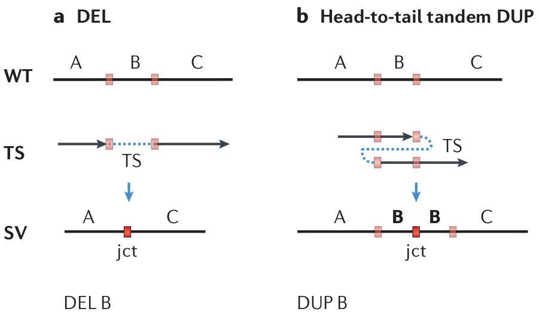
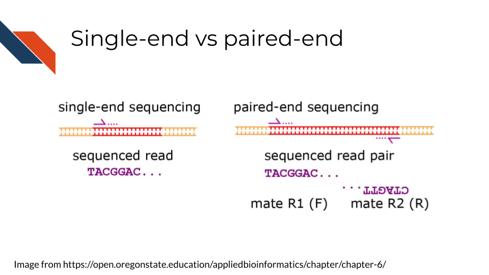
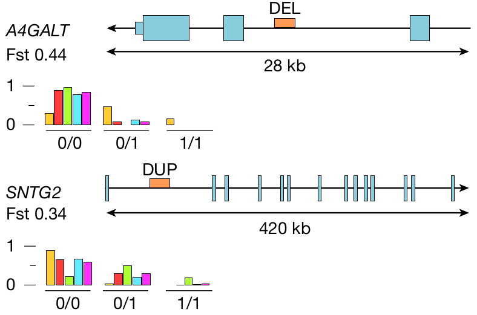
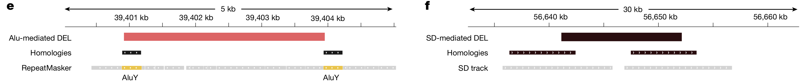

<!-- budget 80 slides -->
<!-- sections: i) mechanisms, ii) population, iii) cancer, iv) fusion, v) visualization -->
<!-- ~15 slides per section -->
<!-- presentation should be < 1 hr -->

## Structural variant (SV)

## What causes endogenous SVs?

:::{.center}

 

**Homology**

ATCGATCG **Seq. 1**
 
AACGAACG **Seq. 2**

 

**Repeats**

TAAAAAAT **Seq. 1**
 
CAAAAAAT **Seq. 2**

:::

::: notes
"Repeats" -> "replication failures".
"Homology" -> "recombination"
:::

## SV types

## Large base pair effect size of SVs

Number of SVs per person seems underestimated

## SV recipe

:::{.small}
:::{.center}
1. Where: homology, repeats, double-strand breaks, and replication forks
2. When: synthesis, recombination, or repair
:::
:::

::::{.columns}
:::{.column width="50%"}
{fig-align="center"}
:::
:::{.column width="50%"}
{fig-align="center"}
:::
::::

::::{.columns}
:::{.column width="50%"}
{fig-align="center"}
:::
:::{.column width="50%"}
{fig-align="center"}
:::
::::

::: notes
maybe animate with 2 slides
:::

# SV mechanisms

## SV mechanism research gaps

 

:::{.center}

- Calling *dependent* SVs
- Calling SVs using sequencing and mechanism models jointly
- Which mechanisms are most frequent?
- Association of mechanisms and pathologies

:::

## Allelic homologous recombination

{fig-align="center"}

## Non-allelic homologous recombination

{fig-align="center"}

## Smith-Magenis syndrome

:::{.small}
:::{.center}

 

NAHR SV near RAI1 and nearby genes on CHR 17

 

{fig-align="center" width="30%"}

:::
:::

## Segmental duplications drive NAHR

 

:::{.center}
:::{.small}

- Segmental duplications (SDs) recruit NAHR
- ~5% of human genome
- High identity (>~95%)
- Large (>~10kbp)

:::
:::

## NAHR DEL-DUP

## NAHR DEL-DUP

## NAHR DEL-DUP

## NAHR elements and risk

 

:::{.small}
:::{.center}

| Homologous element | Min. Seq. identitiy | Min. length | 
| ----- | ----- | ----- |
| Segmental duplication (SD) | 90% | 1kbp |
| Long interspersed nuclear element (LINE) | 96% | smaller than 1kbp |
| Human endogenous retro virus (HERV) | 93% | 3kbp | 

 

- Risk $\propto$ length & sequence identity
- Risk $\frac{1}{\propto}$ distance between elements

:::
:::

::: notes

citation? probably one of the SV mech papers

:::

## NAHR summary

 

:::{.center}

- Recombination at homologous, but non-matching loci
- Breakpoints have large homology
- Example: Smith-Magenis syndrome
- Relatively high reurrency

:::

## Non-homologous end joining (NHEJ)

{fig-align="center"}

## Chronic myeloid leukemia fusion

:::{.small}
:::{.center}
- NHEJ SV hypothesis (minimal breakpoint homology)
- Recurrency hypothesis: CHR9 and CHR22 regions are physically close

:::
:::

{fig-align="center"}

## NHEJ example

{fig-align="center"}

## NHEJ summary

 

:::{.center}

- Imperfect repair of double strand DNA break
- Minimal homology at breakpoints
- Example: BCR-ABL1 fusion CML
- *Usually* low recurrency

:::

## Break-induced replication (BIR)

 

 

{fig-align="center"}

<!-- from Mechanisms underlying structural
variant formation in genomic disorders -->

## Temple syndrome

:::{.center}

 

- BIR SV: CHR 14 DUP-TRP/INV-DUP
- Symptoms
  - Intellectual disabilities
  - Early onset puberty

:::

## BIR summary

- Replication template switching due to microhomology
- Breakpoints show microhomology
- Example: Temple syndrome; CHR 14 DUP-TRP/INV-DUP
- Low recurrency

<!-- ## Template switch DEL and DUP

 

{fig-align="center"} -->

## Fork stalling and template switching (FoSTeS)

:::{.center}

Template switching during replication

 

{fig-align="center"}

:::

## Pelizaeus-Merzbacher disease

 

:::{.center}

- Mechanism: CHR X DUP; PLP1 gene
- Symptoms:
  - Involuntary movements
  - Developmental delays
:::

## FoSTeS summary

:::{.center}

 

- Template switching from one replication fork to another
- Breakpoints have microhomology
- Example: Pelizaeus-Merzbacher disease
- Low recurrency

:::

## SV mechanisms

:::{.small}
:::{.center}

| Mechanism | When | Recurrency | Breakpoint homology | Ex. pathology |
| ----- | ----- | ----- | ----- |
| NAHR | Recombination | Relatively high | Large | Smith–Magenis syndrome; DEL on CHR 17, RAI1 gene |
| NHEJ  | Repair | Low | None or small | Chronic Myeloid Leukemia; FUSION of BCR-ABL genes |
| BIR | Replication | Low | Small | Temple syndrome; DEL on CHR 14 |
| FoSTeS | Replication | Low | Small | Pelizaeus-Merzbacher; DUP CHR X, PLP1 gene | 

:::
:::

::: notes

- NAHR pathology: Mechanisms underlying structural variant formation in genomic disorde
- BIR pathology: https://www.nature.com/articles/s41594-025-01644-z#Sec5 table1
- NHEJ pathology: Distinct pattern of genomic breakpoints in CML and BCR::ABL1-positive ALL: analysis of 971 patients
- FoSTeS pathology: https://pmc.ncbi.nlm.nih.gov/articles/PMC2685756/

:::

## SV mechanism research gaps

 

:::{.center}

- Calling *dependent* SVs
- Calling SVs using sequencing and mechanism models jointly
- Which mechanisms are most frequent?
- Association of mechanisms and pathologies

:::

## Dependent SVs and mechanisms

:::{.center}
:::{.small}
- A single NHEJ event may produce multiple SVs
- NAHR rarely produces insertions
- Breakpoint sequence could rule out SV dependence
  - E.g., INS+DEL with large homology at DEL breakpoints
:::

{fig-align="center" width="75%"}

:::

## Dependent SVs as "Complex SVs"

:::{.center}
Severus

:::{.small}

- Breakpoint coordinates used for merging
- Breakpoint sequence not leveraged for resolving complex SV

:::
:::

{fig-align="center" width="50%"}

## Severus complex SVs

:::{.center}
Annotates a pre-defined set of complex SVs
:::

{fig-align="center"}

## Many coordinates clusterers

 

:::{.center}

Breakpoint sequence not leveraged

 

::::{.columns}
:::{.column width="50%"}
 
{fig-align="center"}
:::
:::{.column width="50%"}
{fig-align="center" width="70%"}
:::
::::

:::

# SVs in human population

## Population SV analyses

 

:::{.small}
:::{.center}

| Paper | Cohort size | Variants | Objective |
| ----- | ----- | ----- | ----- |
| gnomAD | 125,748 exomes & 15,708 genomes | SNV, INDEL, & SV | Quantify gene mutation constraint | 
| 1KG short read | 2,504 genomes | SV | Build diverse human SV set | 
| 1KG long read | 1,019 genomes | SV | Improve human SV set quality via longer reads and graph reference genome |

::::{.columns}
:::{.column width="50%"}
{width="50%"}
:::
:::{.column width="50%"}
{width="50%"}
:::
::::

:::
:::

## Population SV findings

 

:::{.small}
:::{.center}

| Paper | Cohort size | Variants | Major finding |
| ----- | ----- | ----- | ----- |
| gnomAD | 125,748 exomes & 15,708 genomes | SNV, INDEL, & SV | Some genes essential, others dispensable | 
| 1KG short read | 2,504 genomes | SV | Establish & describe global SV reference set | 
| 1KG long read | 1,019 genomes | SV | Mobile elements SVs largely impact genome |

<!-- ::::{.columns}
:::{.column width="50%"}
{width="50%"}
:::
:::{.column width="50%"}
{width="50%"}
:::
:::: -->

:::
:::

## gnomAD

:::{.center}
:::{.small}

Sections

1. Dataset description
2. Negative selection for pLoF variants
3. pLoF-disease association
:::
:::

::::{.columns}
:::{.column width="33%"}
{width="60%"}
:::
:::{.column width="33%"}
{width="100%"}
:::
:::{.column width="33%"}
{width="100%"}
:::
::::

:::notes

Sections
 
1. Sample geographic description (F1ab)
2. Overlap of variants (F1e-h)
3. LOFTEE annotation filter intuits with freq. and MAPS (F2ab)
4. LoF SNVs are empirically constrained (F2cd)
5. LOEUF scores agree with gene annotations (F3)
6. Constraint is larger for genes expressed in many tissues and that interact w/ many proteins
7. LOEUF relation to disease

:::

## Sample geography

:::{.small}
:::{.center}

- 125,748 exomes & 15,708 genomes
- EUR biased

{fig-align="center" width="30%"}

:::
:::

## Genome v exome

 

{fig-align="center"}

## SNVs

:::{.center}
:::{.small}

- SNVs: SNPs relative to reference genome
- SNV analysis is conceptually transferrable to SVs

{fig-align="center"}

:::
:::

## Complexity of 1bp context SNVs

:::{.center}

 

- gnomAD considers SNVs with 1bp context
  - A**C**G -> A**A**G OR A**T**G OR A**G**G
- $4^3=64$ possible 3-mers
- 3 possible SNVs per 3-mer
- Total 3-mer SNVs is $64\cdot 3=192$

:::

## SNV-element overlap

::::{.columns}
:::{.column width="50%"}

:::
:::{.column width="50%"}
{fig-align="center" width="90%"}
:::
::::

::: notes
- Takeaways: i) splice site and nonsense mutations are relatively rare (gh) because ii) they are most likely to cause loss of function (cd).
:::

## SNV-element overlap

::::{.columns}
:::{.column width="50%"}

:::{.small}
- Missense: changes codon -> changes protein sequence
- **pLoF**: predicted loss of function
- **MAPS**: mutability adjusted proportion of singletons
- CpG transition: CG -> TG
- Transversion: Purine (GA) <-> Pyrimidine (CT)

:::

:::
:::{.column width="50%"}
{fig-align="center" width="90%"}
:::
::::

::: notes
- Takeaways: i) splice site and nonsense mutations are relatively rare (gh) because ii) they are most likely to cause loss of function (cd).
:::

## MAPS intution

:::{.center}
Is SNV functional class enriched with rare (singleton) events?
:::

{fig-align="center" width="90%"}

## MAPS

:::{.center}
:::{.small}

- MAPS: Mutability adjusted proportion of singletons
- Aggregate singletons within SNV functional classes (e.g., pLoF or missense)
- MAPS $\approx$ Observed singleton prop. $-\text{ }f$(expected singleton prop.)
- MAPS > 0: more singletons observed than expected
<!-- - Expected: derived from non-coding regions, weighted by mutation rate (freq.) -->

{fig-align="center" width="30%"}

:::
:::

## pLoF negative selection

:::{.center}

 

pLoF mutation rates are constrained to be rare 

{fig-align="center" width="40%"}

:::

## LoF annotation-based filtering

{fig-align="center"}

::: notes

- Example annotation filters: UTR splice site
- LOFTEE filtering agrees with ClinVar annotations and AF

:::

## RNA-splicing

{fig-align="center"}

## LOFTEE

:::{.center}

LOFTEE filter rate intuits with ClinVar annots., AF, and MAPS

{fig-align="center" width="40%"}

:::

## pLoF SNVs emprically under-observed

{fig-align="center" width="50%"}

## pLoF functional consequences

{fig-align="center" width="50%"}

:::notes

- Takeaways: Low LOEUF associated with essential genes
:::

## LOEUF

:::{.small}
:::{.center}

- LOEUF: Loss-of-function observed expected upper bound fraction
- Goal: mesaure intolerance to pLoF
- Approach: score genes by pLoF SNV proportion
- Metric: #Obs. pLoF SNVs / #Exp. pLoF SNVs; take upper bound CI

{fig-align="center"}

:::
:::

## pLoF functional consequences

{fig-align="center" width="50%"}

:::notes

- Takeaways: Low LOEUF associated with essential genes
:::

## Constrained genes PPI and expression

 

::::{.columns}
:::{.column width="50%"}

:::{.center}

 

$\downarrow$ LOEUF $\rightarrow$ $\uparrow$ PPI 

 

 

$\downarrow$ LOEUF $\rightarrow$ $\uparrow$ tissue expression coverage
:::

:::
:::{.column width="50%"}
{fig-align="center" width="75%"}
:::
::::

## Transcript expression bias

 

:::{.center}
Constrained RNA isoforms are highly expressed
:::

::::{.columns}
:::{.column width="50%"}
{fig-align="center"}
:::
:::{.column width="50%"}
{fig-align="center"}
:::
::::

::: notes
- For each gene with >=1 constrained and >=1 unconstrained isoform, they measured expression fraction of constrained transcript
:::

## How apply mutational constraint metrics?

 

:::{.center}

- Diseases/traits are enriched with constrained pLoF variants?
- Relationship of heritability and mutational constraint?
:::

## De novo pLoF SNVs in disease

:::{.center}
:::{.small}

- Rate ratio: #Disesase de novo SNVs / #Control de novo SNVs
- More de novo pLoF SNVs in constrained genes occur in developmental/intellectual disability cases compared to control

{fig-align="center" width="80%"}

:::
:::

## Trait inheritance LOEUF association

:::{.center}
:::{.small}
- Partitioning heritability enrichment
  - \> 1 $\rightarrow$ trait heritability explained by SNVs greater than random chance

{fig-align="center"}

:::
:::

## Trait pLoF SNV association

:::{.center}
:::{.small}
- Null: is trait NOT associated with pLoF variants?
- Schizophrenia and educational attainment previously reported as pLoF associated

:::
:::

## gnomAD summary

:::{.center}
:::{.small}
1. Massive exome dataset, yet biased to EUR ancestry
2. Modeled mutational constraint by pLoF proportion metric (LOEUF) 
3. LOEUF metric aligned with fundamental biology and diseases
:::
:::

::::{.columns}
:::{.column width="33%"}
{width="60%"}
:::
:::{.column width="33%"}
{width="100%"}
:::
:::{.column width="33%"}
{width="100%"}
:::
::::

## 1KG sections

:::{.center}
Sections

1. Introduce SV callset
2. SV element overlap
3. SV association with GWAS SNPs and expression
4. Complex SVs and breakpoints
:::

::: notes
1. SV summary (F1ab)
2. Breakpoint accuracy (F1c)
3. SVs shared across continental ancestry (F1d)
4. SV-SNP linkage disequilibrium (F1e)
5. SV overlap with elements (F2ab)
6. SV expression association, eQTL (F2cd)
7. SVs are in LD with lead eQTL SNP (F2e)
8. SV hotspots (F3a)
9. Complex DELs (F3b)
10. Breakpoint analysis of complex SVs (F3cd)
11. Complex INVs (F3e)

:::

## 1KG SV summary

{fig-align="center"}

::: notes
- Most SVs were not in DGV DB
- INVs were rare relative to copy number variants
- Length of SVs discovered was constrained by tool(-parameters)
:::

## SV callers

{fig-align="center"}

:::notes
- Many DEL callers
- Only 1 INS caller, yet many MEIs called: ~16k
:::

<!-- | Caller | SV type | SV len. range | 
| ----- | ----- | ----- |
| BreakDancer | DEL | (50,$10^6$) |
| Delly | DEL, DUP, & INV | ? |
| VariationHunter | DEL | ? |
| CNVator | DEL | ? |
| Read-depth (SSF) | DEL, DUP, mCNV |
| Genome STRiP | DEL, DUP, mCNV |
| Pindel | DEL |
| MELT | MEI |
| Dinumt | NUMT | -->

## DEL breakpoint accuracy

:::{.center}
:::{.small}
- "True" breakpoints: assembly (TIGRA) and long-reads (PacBio)
- Low VAF SV breakpoints less accurate
- Pindel accuracy; likley due to split-read reliance
:::
:::

{fig-align="center" width="70%"}

## Discordant v split reads

 

:::{.center}
Split reads include breakpoint sequence
:::

 

{fig-align="center"}

## SV ancestry

{fig-align="center" width="70%"}

::: notes
- Many SVs are present in > 1 continental ancestry
- Some relatively common SVs (e.g., AC > 10 ) are present solely in AFR population; this population-distinctness is not observed for other pops.
:::

## SV SNP LD

:::{.center}
:::{.small}

- **LD**: linkage disequilibrium
  - $r^2 \approx 1 \rightarrow$ non-random co-occurence
  - $r^2 \approx 0 \rightarrow$ random co-occurence
- Here, LD measured for SVs and nearby SNPs

:::
:::
{fig-align="center" width="70%"}

## SV element overlap

- Expected: shuffled SVs intersecting with true elements
- Approaches: i) partial overlap and ii) engulf overlap

{fig-align="center"}

## Partial v enguled overlap

 

 

{fig-align="center"}

## SV partial element overlap

- Log enrichment: $<0 \rightarrow$ less overlap than expected
- RVIS: residual variation intolerance score (functional variant intolernace)
  - $\uparrow RVIS \rightarrow$ $\uparrow$ variant tolerance

{fig-align="center"}

:::notes
- left: important elements less constrained for DELs 
- left: higher VAF -> lower chance of element overlap
- right: DELs are usually more constrained than other SV types
:::

## SV expression association

:::{.center}
:::{.small}

- DUSP22: sig. eQTL variants overlaps coding seq.
- ZNF43: sig. eQTL variants are upstream coding seq.

:::
:::

{fig-align="center"}

## SV expression association

:::{.center}
:::{.small}

- eQTL: expression quantitative trait loci
  - Null: no association of SV and gene expression
  - $\downarrow p \rightarrow$ SV associate with gene expression change

:::
:::

{fig-align="center"}

## LD of lead eQTL SNPs and SVs

:::{.small}
:::{.center}
- Hypothesis: sig. GWAS SNPs associated with SVs
- Denom: # expected SVs in LD with lead eQTL
  - Swap SV into another SV region with similar properties (e.g., VAF)
  - Restrict LD search space to +/- Xbps from TSS
  - Constrain haplotype length ($r^2$ [$\downarrow r^2 \rightarrow \uparrow$ haplotype len.])
  - Is lead eQTL SNP in haplotype length? (yes $\rightarrow+1$)
:::
:::

:::notes
- When haplotype length is constrained, # SVs in LD with lead eQTL SNP greater than expected
- The association of lead eQTL SNPs and SV is more likely the large the SV
- Yes, it's possible that traits associated lead eQTL SNPs may actually explained by SVs
:::

{fig-align="center"}

## SV hotspots

 

{fig-align="center"}

:::notes
- What does an SV hotspot look like
- Here is an ~1Mbp region on CHR 19
- There's many SVs and there's many segmental duplications likely driving SV
- Surprisingly 13 genes intersect hotspot locus
- PSG: pregnancy specific glycoprotein; essential for healthy pregnancy
- Maybe the hotspot is overcome by redundancy
- mCNVs here have some ancestry bias for biallelic DELs

:::

## Complex SVs

{fig-align="center"}

:::notes
- Specific classes of complex DELs and INVs were counted
- Breakpoint sequences were analyzed
- Show what alignments look like for complex SVs
:::

## Complex DELs

{fig-align="center"}

:::notes
- Top 4 complex SVs look like repair/replication errors of DNA breakage due to small SVs inside a larger DEL. Or maybe, mobile element INS
- Most commonly DEL regions were filled with INS/DUP seq
:::

## Complex SV breakpoints

:::{.center}
- Red: junction seq. shared with breakpoint seq.
- Green: same as red, but reverse complement
- Blue: No similar neighboring seq. (INS)
:::

{fig-align="center"}

::: notes
- These are probably not NAHR because the homology is relatively small
:::

## Complex SV alignment

 

{fig-align="center"}

## DUPs are commonly INVerted

 

{fig-align="center"}

## 1KG SV SR summary

:::{.center}
:::{.small}
- ~1/2 SV callset novel; samples less biased to EUR than gnomAD
- Negative selection for SVs overlapping conserved regions
- SVs association with trait SNPs (LD) and gene expression (eQTL)
- Complex SV classes recur with characterisitc breakpoint signatures
:::
:::

:::{.columns}
:::{.column width="25%"}
{fig-align="center"}
:::
:::{.column width="25%"}
{fig-align="center"}
:::
:::{.column width="25%"}
{fig-align="center"}
:::
:::{.column width="25%"}
{fig-align="center"}
:::
::::

## 1KG SV LR sections

:::{.center}
Sections

1. Jointly analyzing linear and graph reference SVs
2. SV callset characteristics
3. Mobile elements
4. Breakpoint analysis
:::

::: notes
1. Geographic distribution (F1a)
2. Depth (F1b)
3. SV analysis pipeline (F1c)
4. SV allele freq. (F2a)
5. SV lengths (F2b)
6. Low AF SVs were missing from graph. (F2c)
7. SV count by ancestry (F2de)
8. SV element intersection (F2f)
9. Within continental ancestry Fst (F2g)
10. Example Svs biased to AFR & EAS demographics (F2h)
11. Complex SVs (F3ab)
12. Transduction activity (F4abcde)
13. Breakpoint analysis (F5abcdef)
14. Recurrent SV (F5g)
:::

## Geographical ancestry

 

:::{.center}
Mixed sample geography avoids common EUR bias
:::

{fig-align="center"}

## Long read (LR) depth and size

:::{.center}
:::{.small}
- ~16.9x median coverage
  - $\uparrow$ coverage $\rightarrow$ $\uparrow$ sensitivity to mosaic variants
- ~20.3kbp median read length
  - 100x larger than typical short-read
  - SVs can be contained in a single read
- LR is single-end, not paired-end
:::
:::

{fig-align="center"}

## Single v paired-end seq.

{fig-align="center"}

## Augmented graph SV analysis

:::{.center}

1. Align to 3 different references (GRCh38, CHM13, and HPRC)

:::{.small}
- Linear: GRCh38 and CHM13
- Graph: HPRC
:::
:::

{fig-align="center"}

:::notes
A graph reference uses forking paths to include more than 1 possible sequences
:::

## Augmented graph SV analysis

:::{.center}

2. Call SVs

:::{.small}
- Linear: Delly and Sniffles
- Graph: SVarp
:::
:::

{fig-align="center"}

## Augmented graph SV analysis

:::{.center}
3. Create pseudo-haplotypes

:::{.small}
- Pool SVs by caller
- Create haplotypes such that no SVs overlap within haplotype
- Use bcftools consensus to resolve sequence
- Q: Beyond overlap, what criteria assign SVs to specific haplotypes?
:::
:::

| Caller | #Pseudo-haplotypes |
| :-----: | :-----: |
| Delly | 26 |
| Sniffles | 69 |
| SVarp | 117 |

<!-- {fig-align="center"} -->

## Genotype v haplotype

:::{.center}
:::{.small}
- Genotype: which alleles present and how many?
  - Ex: A/A homozygous SNP at CHR4:123456bp $\rightarrow$ genotype = "1/1"
- Haplotype: which alleles physically linked on singular chromosome?
  - Ex: SNPs at bp 4 (C>A) & 7 (A>C)  are "phased" to same physical chromosome
:::
:::

{fig-align="center"}

## Augmented graph SV analysis

:::{.center}
4. Inject pseudo-haplotype seq. paths
:::

 

{fig-align="center"}

## Augmented graph SV analysis

:::{.center}
5. Genotype (Giggles) and phasing (SHAPEIT5)
:::

 

{fig-align="center"}

## SV allele frequency

{fig-align="center"}

:::notes
- About a 1/4 of SVs are singletons
- About 1/2 are between AC>2 and AF < 50%
- I do not think this plot demonstrates AFR contributes more SVs than other pops.
  - Before AFR samples, about 80% of total SVs are already included
- Maybe compare w/ SR here
:::

## SV length

{fig-align="center"}

::: notes
- Many SVs are smaller than read length
- SV count for illumina was subsetted to long read samples
- Mobile element driven SVs are characterized by length peaks
- Maybe compare w/ SR here
:::

## Graph augment adds low VAF SVs

{fig-align="center"}

## SV count by continent and GT

 

{fig-align="center"}

:::notes
- Counted num. hom/het SVs per individual
- AFR highest SV count
- 2nd place swaps from EAS to AMR for HOM > HET
:::

## SV element overlap

 

{fig-align="center"}

:::notes
- most SVs not intersecting genes (intergenic)
- SV that do intersect coding seqs. have low allele frequency
- maybe compare with SR here
:::

## Within continent SV mixing

:::{.center}
:::{.small}
- $F_{st}$: fixation index
  - $F_{st} \approx 0 \rightarrow$ SVs are well-mixed across continents
  - $F_{st} \approx 1 \rightarrow$ SVs are biases to given continent
:::
:::

::::{.columns}
:::{.column width="50%"}
{fig-align="center"}
:::
:::{.column width="50%"}
 
{fig-align="center"}
:::
::::

:::notes
- AFR & EAS have relatively more SVs that are biased to their continent
:::

## SVs with continent bias

{fig-align="center"}

:::notes
- Top AFR biased DEL
- Bottom EAS biased DUP
:::

## SV sub-classes

:::{.center}
:::{.small}

- Classes resolved by SV annotator (SVAN)
- VNTR: variable number tandem repeat
- ALU: ~300bp mobile element

{fig-align="center"}

:::
:::

::: notes
- VNTR is most common SV class for both DEL and INS
- DEL would remove some section of tandem repeats
- INS would add tandem repeats
- High MAF suggests these variants are not only common in magnitude, but shared across individuals
- Aside from VNTR, most other SV classes have low AF
:::

## INV sub-classes

 

{fig-align="center"}

:::notes
- INV DUP more common than simple INV, tend to be smaller than other INV types
- Overall, beyond mechanism and breakpoints, SV sub-classes have characteristic lengths and AF
:::

## L1 transduction activity

:::{.center}
:::{.small}
Transduction: element is copied and inserted elsewhere
:::

{fig-align="center" width="80%"}
{fig-align="center" width="60%"}

:::

:::notes
- L1: mobile element w/ characteristic ~6kbp length. includes a repeat region
- Takeaway: some mobile elements are more active than others and adjancent seq copied along is biased to the origin of element
- Tail transduction bias except for 3rd origin loci
- Not in GRCh38 nor CHM13 means it was in the graph genome
- Takeaway 2: Prior reports have many of these elements as "non-hot"/inactive, but they seem pretty active here
:::

## SVA transduction activity

:::{.center}
:::{.small}

{fig-align="center" width="80%"}
{fig-align="center" width="50%"}

:::
- SVAs are about 2-3kbp length elements
- Within element, there is bias for head/tail transduction, but across elements is well-distributed
- Greater reference agreement compared to L1 activity
- Subfamily is more entropic than L1
:::

## Singular 5' L1 transduction

::::{.columns}
:::{.column width="50%"}
 

:::
:::{.column width="50%"}

:::
::::

:::notes
- Takeaway: Transduciton is slightly CHR biased and many events are near ends of chromosome
- Source strand is reverse. Slight bias to forward strand targets
:::

## L1 transduction alignment

{fig-align="center"}

:::notes
- This L1 element is nearby a promoter and RNA-splicing may include the L1 element allow it to travel and recombine elsewhere
- CAGE read counts measure TSS reads
:::

## Breakpoint analysis

 

{fig-align="center"}

:::notes
- BLAST used to measure breakpoint homology
- Word size is min. exact match
:::

## Breakpoint homology

{fig-align="center"}

:::notes
- Some SVs have characteristic lengths and breakpoint homologies: SDs and Alu do. VNTR not so much

:::

## Breakpoint homology

{fig-align="center"}

:::notes
- Takeaway: Homology by type agrees with mechanistic models
- Example NHEJ (dark gray) has small homologies
- SD (black) has large homologies; although these SVs are more rare
- Takeaway 2: many SVs detected are smaller than median read size (20.3kbp)
- Q: are smaller SVs more common or is this a technology bias?
:::

## Example DEL SV breakpoints

 

 

{fig-align="center"}

:::notes
Again, ALU homologies are smaller than SD homologies
:::

## Recurrent ALU DEL

 

{fig-align="center"}

:::notes
- Haplotype clustering by SNPs in a 100kbp window
- Clusters were biased to continent: i) EAS, ii) AFR, iii) SAS
- DEL SV present in clusters 2 and 3 and 1 outlier sample
- "Recurrence-indicating" SNPs highlighted in red. Maybe LD?
:::

## 1KG SV LR summary

:::{.center}
:::{.small}
<!-- 1. Jointly analyzing linear and graph reference SVs -->
1. Genotyped and phased SVs using augmented graph
2. SVs lengths were generally smaller than read length
3. Mobile elements contribute ~1/3 total bp SV-driven variation in humans
4. Large variation in mobile elements
5. Breakpoint analysis agrees with mechanistic models
:::
:::

::::{.columns}
:::{.column width="33%"}

 

{fig-align="center"}
:::
:::{.column width="33%"}

 

{fig-align="center"}
:::
:::{.column width="33%"}
{fig-align="center"}
:::
::::

## SVs in pop. summary

:::{.center}

- SVs and SNPs often dependent (high LD)
- SV location is constrained 
- Mobile elements frequently cause SVs
- Empirical breakpoints agrees with mechanistic hypotheses

:::

## SV-SNP dependence

::::{.columns}
:::{.column width="50%"}
{fig-align="center" width="70%"}
:::
:::{.column width="50%"}

 

{fig-align="center" width="70%"}
:::
::::

## SV location constraint

 

 

::::{.columns}
:::{.column width="70%"}
{fig-align="center"}
:::
:::{.column width="30%"}
{fig-align="center"}
:::
::::

:::notes
- SR: SVs in variation intolerant coding regions (low RVIS) were less than expected at random
- LR: total number of CDS altering SVs was lower than overlap with other elements
:::

## Mobile element SVs

 

{fig-align="center"}

## Empirical breakpoints match models

:::{.center}

{fig-align="center" width="60%"}
{fig-align="center" width="60%"}

:::

:::notes
- Homology size of breakpoints depends on SV mechanism
:::

## SVs in pop. future work

:::{.center}
- Joint seq-mechanism callers
- Variant prioritization
- Mobile element detection and inspection
:::

:::notes
- Leverage mechanistic models during call process rather than post-hoc annotation
- Use large SV callsets as background control to prioritize SVs driving disease. If frequent in these cohorts, unlikely to drive disease
- Mobile elements cause a significant amount of SVs, yet majority of callers focus on DELs and copy number variants
:::

## Chromothripsis v chromoplexy

:::{.small}
:::{.center}

{fig-align="center" width="50%"}

| SV | Chromosome(s) | Copy number change |
| ----- | ----- | ----- | ----- | ----- |
| Chromothripsis | 1 or few | Relatively high |
| Chromoplexiy | Usually multiple | Relatively low |

:::
:::

## PCAWG

:::{.center}
Sections

1. Variant caller evaluation
2. Driver mutations
3. Clustered variant events
4. Germline and somatic variant associations
5. Telomere mutations
:::

:::notes
1. Variant caller evaluation (F1)
2. Driver mutations (F2,3)
3. Clustered variant event occurence and characteristics (F4,5)
4. Germline and somatic variant associations (F6)
5. Telomere mutations (F7)

:::

## Variant caller evaluation

:::{.center}
For 50 samples, deep sequencing of target (variant-site) probes
:::

{fig-align="center"}

::: notes
Methods with good precision and recall (light blue) were selected
:::

## Low VAF challenges

 

{fig-align="center"}

:::notes
- Rare variants (low VAF) are hard to detect and false positives are common
- intuitively, signal-noise ratio is smaller
:::

## Driver mutations

{fig-align="center"}

:::notes
- Takeaway: severe cases have many types of SVs
- Takeaway 2 (bar): most patients have driver coding point mutation or SCNA (gene variants)
- angle separates samples
- outer:  sorted driver mutations per sample
- ii) Whole genome duplication presence (both homologous chromosomes are duplicated, could be just one pair)
- iii) Tumor type (color)
- iv) # driver CNVs
- v) # driver non-CNV rearrangements
- vi) # driver coding point mutations
- vii) # driver non-coding mutations
- viii) # Pathogenic germline variants
:::

## Gene driver variants

{fig-align="center"}

:::notes
- Notable: TP53 is most common driver mutation, TERT also common (telomere repair)
- Notable: cis-activating GR (GR=genomic rearrangement) prostate only ERG-TMPRSS2
- Notable: fusion BRAF in melanoma and CNS-piloastro
- Notable: many drivers deactivate tumor suppressing genes (TSG, light blue)
:::

## TSG DEL drivers

:::{.center}
TSG: tumor suppressor gene
:::

{fig-align="center"}

:::notes
- Bottom value: # patients w/ bi-allelic DEL DIV total # patients w/ somatic VAR in gene
- Notable: TP53 usually only heterozygous DEL
- Takeaway: homozgyous DEL is relatively uncommon compared to heterozgyous DELs
:::

## Missing driver investigation

:::{.center}
- 4/181 driver-free samples had >5% normal contamination
- DeTiN tool re-analyzed and found drivers
:::

{fig-align="center"}

:::notes
- Takeaways: i) some samples' drivers were rescued after addressing tumor-in-normal contamination (a)
- Takeaways: 2) for TERT-sensitive cancers many samples depth and purity was estimated insufficient to detect TERT mutations (bc)
- a) contamination measured by variant allele frequency difference in tumor and normal
- b) Estimated mutation detection sensitivity given purity and depth
- Again, this was only done for samples w/o drivers
- c) TERT detection sensitivity in cancers where TERT is commonly mutated

:::

## Clustered variant events

{fig-align="center"}

:::notes
- Takeaway a: Most kataaegis events were APOBEC3 type, except for lymphatic cancers
- Takeaway a: chromoplexy less common than kataegis
- Takeaway a: chromothripsis high variance across tumor types
- Takeaway b: neighboring kataegis events are rare, but some occur near driver genes
- b: radius inv prop to dist of kataegis events
- b: each dot is a kataegis event and its radial location is the distance to next event (sequential)
- APOBE3B-type means up-regulated
:::

## Chromoplexy and chromothripsis

 

{fig-align="center"}

:::notes
- Takeaway c: neighboring chromoplexy events are even more rare than kataegis events
  - Fewer dots in shaded region
- Takeaway d: chromothripsis events with smaller avg breakpoint in the SV cluster tend to cause CNV of driver genes
:::

## Sub-clonal events occur later

{fig-align="center"}

:::notes
Clonal: mutation in most tumor cells
Subclonal: mutation in subset of tumor cells
:::

## Clustered event timing

{fig-align="center"}

:::notes
- Kataegis usually happened later
- Chromothripsis sometimes happend early
- Takeaway: more likely that chromothripsis is driving than kataegis
:::

## Chromothripsis at driver genes

{fig-align="center"}

:::notes
- Takeaway: chromothripsis in melanoma led to copy number gains of TERT (telomere repair) and CCND1 (promotes S phase)
- A lot SNPs (dots) and SVs (arcs)
:::

## Germline-somatic association

{fig-align="center"}

:::notes
- Takeaway: 30 kbp germline DEL known to increase breast cancer risk
:::

## BRCA1 PTV germline enriched somatic SVs

{fig-align="center"}

:::notes
- BCRA1 (DNA repair) PTV SNPs are rare in germline, but when they do appear, many somatic SVs called template INS occurs
- Takeaway: Long read sequencing example of somatic INS+DUP complex SV
:::

## PTVs increasing somatic CpG SNPs

{fig-align="center"}

:::notes
- Blue (BRCA2): germline PTV led to lower somatic mutation rates
- Red (MBD4): germlinePTV led to higher somatic mutation rates
- P-values are from regression two-sided hyp. test
:::

## Germline L1 elements active in cancer

{fig-align="center"}

:::notes
- Takeaway: L1 loci previously known as hot have highest ranking individual contributions, but many non-hot elements contribute to somatic SVs too
:::

## Telomere tumor patterns

:::{.center}
Features: #SVs, length tumor/normal, etc.
:::

{fig-align="center"}

:::notes
- T: tumor
- N: normal
- Takeaway: Most tumor samples fall into the T4 cluster
- They analyzed telomere gene mutations for these clusters
:::

## Telomere cluster causes

{fig-align="center"}

:::notes
- Takeaway c: cluster 4 mostly explained by SNP TERT mutations and RB1 (TSG) mutations
- Takeaway d: TERT promoter SNVs or ATRX/DAXX mutations were common mutations in cancers known to have abnormal telomere regulation
:::

## PCAWG summary

<!-- 1. Variant caller evaluation
2. Driver mutations
3. Clustered variant events
4. Germline and somatic variant associations
5. Telomere mutations -->

:::{.center}
1. Selected SNP/SV callers by evaluating a pilot sample set
2. Driver mutations vary by tumor type
3. Clustered event (e.g., chromothripsis) timing variation
4. Germline-somatic variant association
5. Telomere mutations
:::

::::{.columns}
:::{.column width="33%"}
{fig-align="center"}
:::
:::{.column width="33%"}
{fig-align="center"}
:::
:::{.column width="33%"}
{fig-align="center"}
:::
::::

## PCAWG SV

:::{.center}
Sections

1. SV types and tumor frequency
2. Template insertion SVs
3. SV features and signatures
:::

## SV types

{fig-align="center"}

:::notes
- "cut/copy" -> loss/gain in copy number
- "simple/complex". complex usually has >2  breakpoints
- SVs worth discussing
  - local n-jump: DUPs and INVs
  - Cyclic template INS: copy number gains with shared-chaining breakpoints
:::

## SV tumor frequency

{fig-align="center"}

:::notes
- Takeaway a): Complex/unclassified SVs were typically most abundant, ii) DEL and tandem DUP were frequent simple types, and iii) some cancers with only a few samples had highest SV count (top value per subplot is # samples)
- a) subpanels sorted by total SV count
- Takeaway b): Esophagal cancers had a lot DEL, Tandem DUP, and complex SVs. And DELs dominanated highest SV count samples of Ovary
- The majority of this paper is describing a few categories of complex SVs
:::

## Template insertion SVs

{fig-align="center"}

:::notes
- a) Cycle: the sequence of SV breakpoints returns to source and the source copy is also gained
- b) Chain: sequence of gains, but no return to source
- c) Bridge: same as cycle, but the source copy is not gained (neutral)
- Sequence path is resolved purely by breakpoints
- Q: how do we know breakpoint chains are not just due to hotspot regions?
:::

## Liver TERT cycles

{fig-align="center"}

:::notes
- Hypothesis: TERT amplification and inc. telomere resistance may be due to these template insertion cycle events
:::

## Local n-jumps

{fig-align="center"}

:::notes
- Local n-jumps result in a copy # gain with an inverted segment
- Takeaway: high counts of various jump types in different cancers
:::

## Bimodal size distributions

{fig-align="center"}

:::notes
- Takeaway: DEL and template INS SVs concentrate at two modes: 1kbp and 100kbp
- 1kbp SVs may be due to mobile elements like L1 or SVA
- 100kbp is quite large and not easily explained by mobile elements
:::

## SV properties

{fig-align="center"}

:::notes
- Takeaway: DEL and DUP often have opposite median shifts
- Takeaway 2: small DELs left less likely than random, but large DELs more likley than random w.r.t gene regions
- star: means significant KS hypothesis test (not-uniform)
- LAD: lamine association domain: associated with nuclear envelope management
- Compared with quantile distribution of random SV placement
:::

## Breakpoint microhomology

{fig-align="center"}

:::notes
- Takeaway: smaller breakpoint homology was more likely
- Unclear if peaks occured at bp sizes > 50 which might be due to mobile elements
:::

## Breakpoint element enrichment

{fig-align="center"}

:::notes
- Takeaway 1: Enrichment of transduction/repeat elements (mobile/homologous)
- Takeaway 2: Depletion of SVs connecting fragile regions and genes
:::

## SV signatures

{fig-align="center"}

:::notes
- Takeaway: Tandem DUPs often occur with other SV types
- Takeaway: Chromoplexy events are more often cyclic events rather than chains. Meaning the source chromosome also has copy gain
- Takeaway: INVs are crucial for fold-backs (Breakage fusion bridge)
- Columns: signatures
- Rows: SV type, size, timing
- Bar: how much SV class contributes to signature
:::

## Signature and tumor gene association

 

{fig-align="center"}

:::notes
- Takeaway: BRCA1 associated with both DEL and DUP sigs, while BRCA2 is only associated with DEL sig. Again, these are both DNA repair genes
- Regression hypothesis test. Regresss signature intensity onto binary variable of mutation status
:::

## PCAWG SV summary

<!-- 1. SV types and tumor frequency
2. Template insertion SVs
3. SV features and signatures -->

:::{.center}
:::{.small}
1. Description and quantification of complex SVs: template insertions and n-jumps
2. Signatures abstractly summarize composed SVs and features
:::
:::

::::{.columns}
:::{.column width="50%"}
{width="70%"}
:::
:::{.column width="50%"}

:::
::::

## SV cancer review

:::{.center}
Sections

1. SV discovery methods
2. Driver SVs
3. Mechanisms
:::

## SV discovery methods

:::{.small}
:::{.center}

| Method | Advantage | Limitation |
| ----- | ----- | ----- |
| Karyotyping | Chromosome-level & large SV events | Low res. |
| Array CGH | Custom probes | Incomplete coverage |
| SR WGS | High res. | Small read-context & mapping issues |
| LR WGS | High res. & large read-context | Worse base pair accuracy |
| SC | Phasing | Cell sampling bias & limited tooling |
:::
:::

{fig-align="center" width="50%"}

## SV drivers and type

{fig-align="center"}

:::notes
- Takeaway a): Majority of driver SVs directly affect genes
- Takeaway b): Some cancers have higher SV avg. per sample (top 2/3) than other cancers (bottom 1/3)
:::

## SV mechanisms

{fig-align="center"}

:::notes
- Takeaway a): Some SVs have temporal dependence on precursor SVs
  - Ex: C) Telomere event -> fusion ->  dicentric chromosome -> BFB
:::

## SV cancer review summary

:::{.center}
1. SV discovery method tradeoff
2. Common driver types: coding SNPs and copy # changes
3. SVs involving DNA repair genes have cascading effects
:::

::::{.columns}
:::{.column width="33%"}

:::
:::{.column width="33%"}
{width="80%"}
:::
:::{.column width="33%"}

:::
::::

## Summarize sections

# Gene fusions

## PCAWG RNA

:::{.center}
Sections

1. eQTL variants
2. Alternative splicing
3. Gene fusions
4. DNA v RNA drivers
:::

## eQTL variants

{fig-align="center"}

:::notes
- Takeaway: for germline eQTL variants, the overlap with epigenetic regions was usually not sig. diff. from GTEx (non-tumor) cohort
- procedure
  - i) find germline eQTL variants
  - ii) Quantified enriched overlap with epigenetic regions
  - iii) Compare enrichment with GTEx (non-tumor samples)
:::

## Expression variance factors

{fig-align="center"}

:::notes
- Takeaway: somatic copy number variants had largest effect on expression, surprisingly exon variants explained low expression variance
:::

## Bivalent promoter lead eQTL

:::{.center}
- TEKT5: testicular cancer associated
- Bivalent: marked with both active & repressive chromatin marks
:::

{fig-align="center"}

:::notes
- TEKT5: sperm mobility and integrity. relevant for testicular cancers
- Takeaway: eQTLs were at a bivalent promoter.
- Bivalent promoter: sensitive to either up/down-regulation
- Takeaway: TEKT5 is usually subject to up/down-regulation
:::

## Allelic expression imbalance

{fig-align="center"}

:::notes
- AEI: uneven expression of 2 different gene alleles
- Here, CA haplotype has drives larger expression than TG haplotype
:::

## Allelic expression imbalance

{fig-align="center"}

:::notes
- Takeaway: somatic PTV SNPs ("stop-gained") variable had largest change in odds under a logistic regression model
:::

## Alternative splicing variants

{fig-align="center"}

:::notes
- Takeaway: Variants near exon-intron boundaries are most likely to cause alternative splicing
- Dark blue: # of events associated with exon skipping
:::

## Alternative splicing variants

{fig-align="center"}

:::notes
- Takeaway: Example somatic variant creating novel transcripts via exonization of intron
- Red: tumor. Gray: non-tumor
:::

## Alternative splicing variants

{fig-align="center"}

:::notes
- Takeaway: Reverse strand Alu elements commonly involved in splicing alternative variant events. Specifically, reverse strand transductions.
:::

## Gene fusions

{fig-align="center"}

:::notes
- Takeaway: majority of fusion calls were novel, small subset were recurrent (>1 individual)
:::

## Dual-translocation fusion

{fig-align="center"}

:::notes
- Takeaway: fusions can occur on a chromosome non-native to either constituent gene
- Here: ETV is from CHR12 & NTRK is from CHR15, yet they are both translocated to CHR6 resulting in a fusion.
- Empirically, about 1/5 of fusions with SV evidence were of this type called "bridge fusions"
:::

## DNA & RNA alterations by tumor

:::notes
- Heiarchical clustering using alteration type counts per tumor
- Takeaway i): alternative splicing variation across tumor types is extreme. Is this due to detection sensitivity or biology?
- Takeaway ii): the heterogenity across tumor types for alteration counts is high. Tumor-wise analyses may be necessary
:::

## Driver gene DNA & RNA alterations

:::notes
- Driver gene is union of PCAWG and COSMIC driver genes
- Takeaway i): RNA driver gene alterations are more common (green) than DNA driver gene alterations
- Takeaway ii): Some driver genes are biased more toward DNA alterations or vice versa. Ex: TP53 tends to be driven by DNA alterations
:::

## PCAWG RNA summary

:::{.center}
:::{.small}
1. SCNA variants explained a large amount of expression change
2. Splice altering variants cluster at exon-intron boundaries
3. "Bridge" fusions are relatively common
4. Driver gene bias toward DNA/RNA alterations
:::
:::

::::{.columns}
:::{.column width="33%"}

:::
:::{.column width="33%"}

 

:::
:::{.column width="33%"}

 

:::
::::

## Fusion benchmarking

:::{.center}
Sections

1. Fusion calling strategy and evaluation
2. Simulation eval.
3. Cancer cell line eval.
:::

## Fusion calling strategy

:::{.center}
- 18 alignment-based methods
- 5 assembly-based methods
:::

{fig-align="center"}

:::notes
- Takeaway: 2 core strategies: i) raw read alignemnt (short contigs) and ii) Transcript assembly then alignment
- Takeaway 2: the units of fusion evidence are i) discordant/spanning reads and ii) split/junction reads
- Discordant reads are specific to paired-end technology: each mate maps fully to another gene
- Split reads are evidence in single or paired-end read techs: the read partially maps to both genes
:::

## Fusion calling evaluation

{fig-align="center"}

:::notes
- Takeaway: Use classification metrics to compare tools and select parameters (e.g., min. supporting reads per call)
- Problem: full truth set is typically unknown
- Precision = TP/ \hat{P}
- Recall = TP / P
- F1 combines recall and precision
:::

## Simulated evaluation

{fig-align="center"}

:::notes
- Takeaway a): read methods outperform the assembly methods (Trinity and Jaffa-assembly)
- Takeaway a): Most methods performed better with longer read lengths, except SOAPFuse and Fusionhunter (older tools probably tuned to older seq. tech with smaller read lens)
- Takeaway a): best performers were Arriba, pizzly, STAR-Fusion (highest auPRC)
- Takeaway b): Higher fusion expression led to higher recall
:::

## Cell line evaluation

:::{.center}
- Experimentally validated fusions from 4/60 cell lines
:::

{fig-align="center" width="60%"}

:::notes
- Only showing fusions called by 3 or more methods here
- Takeaway a) recall highest for tools that performed best in simulated eval
- Only 1 exp. val. fusion found by single method (FusionCatcher)
- b) left VA is recall of validated fusions, bars
- b) right VA is precision of ensemble calls (intersection), blue line
- Takeaway b):  Precision asymptotes at about 10 caller agreement
- Takeaway b): recall falls off at about 11 caller agreement
:::

## Cell line evaluation

:::{.center}
- 56 cell lines
- "Wisdom of crowds" defines TP & FP
:::

{fig-align="center"}

:::notes
- Let caller agreement threshold vary from 1,...,23 and compute TP and FP for each case -> perf. dist.
- Takeaway i): again STAR-Fusion and Arriba perform the best (raw read aligners) while assembly methods perform worst (Trinity)
- Takeaway ii): Top and bottom rankings hardly vary as caller agreement threshold changes, but middle rankings do change
:::

## Runtime

{fig-align="center"}

:::notes
- Takeaway i): Pizzly, STAR, and Arriba are also fastest alongside having high classification perf.
- However, STAR 'kickstart' is no longer supported/recommended
:::

## Cell line evaluation

{fig-align="center"}

:::notes
- At caller agreement = 7 definition of TP and FP,
- Takeaway: STAR-Fusion has both high precision and recall. Arriba is a close second
- Takeaway 2: The assembly-based mehods have high precision, but low recall.
:::

## Fusion benchmark summary

:::{.center}
1. Raw read mapping methods outperform transcript assembly methods
2. STAR-Fusion and Arriba are top-performers
3. Similar results for simulated and cell line evaluation
:::

::::{.columns}
:::{.column width="50%"}

:::
:::{.column width="50%"}
{width="55%"}
:::
::::

## STAR-Fusion

:::{.center}
Sections

1. Pipeline
2. Benchmarking
:::

## STAR-Fusion pipeline

{fig-align="center"}

:::notes
- Align reads
- Count discordant & split reads involving genes
- Apply various filters
:::

## STAR-Fusion filters

:::{.center}
:::{.small}
- Split read min. alignment size (25bp each)
- Ignore minority breakpoint contributers
- Homology
- "Promiscuous" genes (many fusion partners)
:::
:::

{fig-align="center"}

## Evaluation

:::{.center}
{fig-align="center" width="60%"}
{fig-align="center" width="60%"}
:::

:::notes
- Same simul. and cell line data was used for evaluation. Similar results
:::

# Visualization

## Motivation

## UCSC genome browser

:::{.center}
Sections

1. Jointly view omics annotations
2. Efficiently view different resolutions

## Genome feature comparison

{fig-align="center"}

:::notes
- Browser is relatively old, but still useful to-date
- Why useful?
- i) Comparing multiple annotation types jointly using tracks is useful for hypothesis generation; historically, finding new human genes
- ii) Annotations can be expensive to compute. A pre-computed set of annotations accessible from web saves significant time.
:::

## Efficient variable resolution

{fig-align="center"}

:::notes
- Hierarchical feature indexing enables fast lookup
- Features are indexed to the smallest bin that contains them
- Takeaway: Can efficiently lookup relevant subset of features in a region or that intersect another feature
:::

## UCSC genome browser summary

:::{.center}
1. Efficiently view genomic features as tracks
2. Pre-computed annotations available from web
3. Updates support various genomic file format tracks
:::

## Samplot

:::{.center}
Sections

1. Samplot examples
2. VCF support
3. Image-driven SV filtering
:::

## DEL

:::notes
- Takeaway: samplot can enables rapid verification of SV events
- Uses tracks to view multiple forms of SV evidence
- Track 1: short-read seq alignments
- Alignment tracks directly show SV evidence at high resolution
  - Connected squares are discordant paired-end reads
  - Dashed lines are split reads
  - Grey background distribution is coverage (reads aligned per base)
- Track 2: PacBio long-read seq alignments
- Track 3: Repeat annotation
- Track 4: Gene annotation with exons
:::

## DUP and INV

## Appendix

- [Papers](https://docs.google.com/document/d/1ITRce8UJdXp1rDq0sjtYXVW5guFNf2iaTkP0BkiCHbA/edit?usp=sharing)
